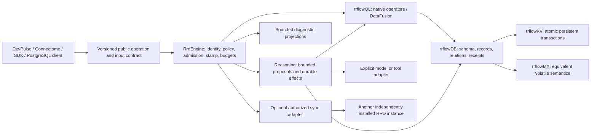
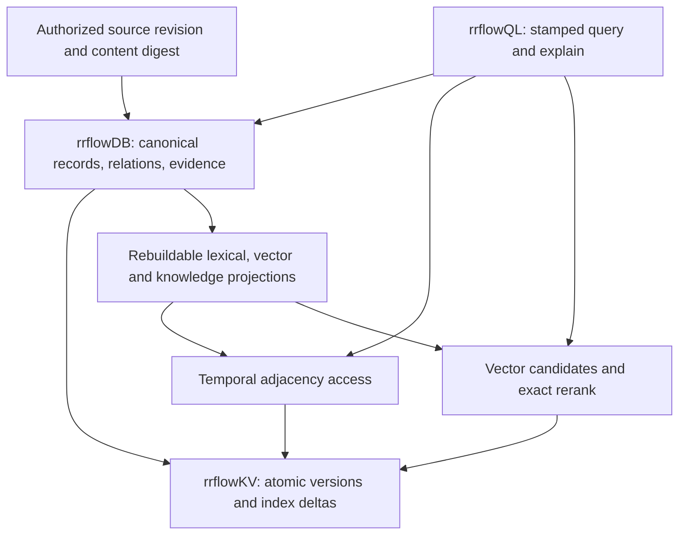

# RRFlow scale and contract design rationale

**Status:** active researched target design; implementation and capacity unqualified
**Coordinate:** `rrflow://rrflow-instance/data/architecture/engine-scale-and-contracts`
**Owner:** researched tradeoffs supporting existing schema, execution, signal and qualification owners
**Reviewed:** 2026-10-24

Keep the native engine foundation and repair or complete its canonical paths.
Do not replace rrflowKV with a vendor database, copy an upstream engine tree,
or mistake existing Rust types for an implemented reasoning service.
This record explains decisions; the [dependency spine](../roadmap/rrflow-1.0/executable-dependency-spine.md)
still owns order, [Gate G](../roadmap/rrflow-1.0/gate-g.md#bounded-reasoning-implementation-packages)
owns reasoning packages, and [Gate J](../roadmap/rrflow-1.0/gate-j.md#capacity-and-optimization-qualification)
owns capacity experiments and release evidence. No gate is completed here.

## Code-grounded starting point

Original design inspection revision (2026-10-20): `554ce4ccf1cb25aceba036dafaf4c8df79c42701`.
These are bounded design inputs, not a replacement source inventory:

| Boundary inspected | Preserve | Repair or complete, with existing owner |
|---|---|---|
| `rrd-engine/src/engine/invocation.rs` and PR 32 | Per-admission ownership, authorization and audited completion | The process-local reservation is not a durable reasoning lease or resume checkpoint. G-02/G-04 and I-03 must bind durable work separately. |
| `rrd-engine/src/engine/inference.rs::generate_embeddings_at`; `rrd-inference/src/lib.rs::EmbeddingBackendRegistry::embed_batch` | Model provenance, input/output validation, explicit network policy | The inspected baseline held the registry mutex through backend work. The current single-slot admission repair below removes that coupling; configurable concurrency, cancellation and complete resource reclamation remain G-01/G-06 and POAM-009 work. |
| `rrd-contract/src/router.rs`; kernel/public `reasoning_tree.rs` | Existing descriptor, request, three-decision and cursor contracts | Admission and schema validation exist; executable router dispatch and persisted tree execution remain G work. `TaskRecord` open/close is not a reasoning worker. |
| `rrd-query/src/fusion.rs::RrdSnapshotTableProvider`; `arrow.rs` | Stamped execution, honest unsupported filters and existing budget evidence | Replace eager Arrow snapshots with the accepted storage stream; account for allocations before and after DataFusion. F-01/F-02/F-04; POAM-004. |
| `rrd-core/src/schema.rs`; public data and generated surfaces | One explicit logical table map, atomic schema/data mutation, generated projections | Add admitted semantic contracts and versioned validation at the owning boundary, not handwritten competing API schemas. H-04/H-08 and the schema catalogue. |
| `rrflow-eval/src/main.rs::Trial` and existing component evidence | Paired provider trials and retained failure evidence | The current trial record is not the complete engine workload manifest or saturation harness. J-02/J-04; POAM-012. |

The installed lifecycle now has native process evidence. Full installed
durability, inventory, indexes, streamed analytics, routing, SQL compatibility
and sync still require their named acceptance tests. Fix demonstrated failures
in place; replace an implementation only after mapping its behavior and tests
to the canonical replacement. In particular, retain accepted segment v6,
the shared transaction port and the measured cache policy.

## Next executable cut

The 2026-10-24 review starts from public main `94d0567f`. The earlier
revision of this record incorrectly treated D-01 installation and H-05a
build identity as work to start; their owning records now carry implementation
and evidence. Preserve those accepted boundaries and follow the current
[C-07 execution reset](../roadmap/rrflow-1.0/gate-c-07.md#execution-reset-after-the-failed-desktop-corpus).
Do not rebuild installation or introduce another build/configuration identity.

The next acceptance sequence is integrated growth repair, frozen full-corpus
preflight, the required allocation/load/seed/reopen/24-hour-soak matrix, then
the existing acceptance collector. [PR 126](https://github.com/rrflow/rrflow-development/pull/126)
contains the integrated growth and native failure repairs; live CI and campaign
results belong to their exact candidate receipts, not this design note. A
successful Desktop operating point cannot qualify the other Desktop points,
Single, Fleet or Cold profiles. A short preflight cannot qualify a 24-hour soak.

During that run, the existing [local database example](../reference/sdk/rrflowdb-local.md)
can exercise the public engine independently: initialize schema/records/edge,
verify one committed view, update, abort, reopen and verify retained state.
Its `read` binds both queries to one known cursor; `verify open|done` checks
independent expected values and refuses partial or differently stamped output.
This is usable DB/graph/QL integration evidence, not vector quality, model
reasoning, PostgreSQL compatibility or cloud-sync qualification.

After C-07 acceptance, resume the existing source-inventory/knowledge path,
E/F index and streaming, G bounded inference, and H public-client/UI packages
in dependency order. The [C-07 prompt/knowledge/UI handoff](../roadmap/rrflow-1.0/gate-c-07.md)
and [engine data-flow owner](engine-data-flow.md) already describe that complete
flow. Keep cost, freshness, cancellation and source-change readback in those
acceptance oracles; no additional global checklist or engine authority is needed.

## One engine across desktop and service

This is the target interaction graph, not a claim that every arrow is live.
The [topology](instance-topology.md) keeps one project/estate/instance identity.
Scale a service fleet by placing independently authorized estates on more
capacity first. A control plane may place, authenticate and monitor estates;
it does not become their transaction authority. Private project VMs and
containers remain outside the database process.

A large estate first gets measured vertical headroom, native indexes, bounded
streaming and admission control. Intra-estate replication/sharding follows the
[distributed contract](../reference/distributed/cluster-contract.md), with
quorum, membership, fencing, placement and recovery qualification. Client
sync is not consensus replication. No cluster or HA claim follows from
running several single-node binaries.

Qdrant documents a useful small/large-tenant placement tradeoff, but its
shared-collection model is not RRFlow's estate topology. Use noisy-neighbor
and movement tests as reference behavior; do not import its collection or
shard authority. [Qdrant multitenancy](https://qdrant.tech/documentation/manage-data/multitenancy/)
supports that comparison, not an RRFlow performance claim.

## Bounded execution before more concurrency

Admission must reserve execution slots and byte budgets before allocating
large inputs or launching a provider. Keep separate bounded classes for
interactive recall, model work, ingestion/index maintenance and transfer.
Reserve operational capacity for cancellation/readiness/recovery; a full model
queue must not prevent observing or stopping the engine.

The budget is hierarchical: host/service allocation, estate, request, stage
and backend. A child may reduce a budget, never expand it. Queue waiting counts
against the request deadline. Measure queue wait, actual execution, lock wait,
model time and durable commit independently. Schedule fairly across estates
and requests; do not confuse DataFusion operator fairness with tenant fairness.

For model adapters, take an immutable descriptor/handle under a short registry
lock, then execute outside it. A backend that needs exclusive mutable state
gets its own bounded worker or permit. A per-backend worker still belongs to
`RrdEngine` admission; it has no independent durable job state. Avoid replacing
one global mutex with unbounded spawned work. Preserve descriptor revision and
credential revocation checks across queueing.

The [embedding admission repair](../evidence/change-journals/gate-g/g-01a-embedding-admission-repair.md)
applies that separation to the existing synchronous path. It preserves the
previous one-batch execution ceiling and rejects contention immediately;
listing and adapter installation use only the short catalogue lock. Selection
pins the admitted descriptor and registry revision, descriptor drift rejects
results, and an owned permit remains held through execution and validation.
There are no spawned workers, waiting queue or claimed cancellation. The
failure corpus uses controlled channel ordering and simultaneous admission,
not a throughput benchmark or full deterministic-simulation system. This is a
bounded POAM-009 repair; G-01a must still qualify configurable parallelism,
deadlines, revocation, cancellation and late output before raising the ceiling.
Rust's [mutex semantics](https://doc.rust-lang.org/std/sync/struct.Mutex.html)
explain why a backend panic is confined to its own adapter lock; poisoning is
advisory and is not a substitute for descriptor/result validation.

Tokio explicitly documents that a started blocking task cannot be aborted by
dropping/aborting its handle. Therefore a timeout may stop waiting without
stopping work. Keep permits and memory reservations until termination is
confirmed; use cooperative cancellation or an explicitly supervised,
bundle-contained worker process where hard interruption is necessary.
Uncertain completion is visible and cannot authorize another effect.
[Tokio shared state](https://tokio.rs/tokio/tutorial/shared-state) and
[Tokio 1.53.1 blocking work](https://docs.rs/tokio/1.53.1/tokio/task/fn.spawn_blocking.html)
are the reference semantics.

Overload rejects or sheds work before expensive execution, with bounded
retry hints and a declared retry budget. Invalid input, denied permission and
permanent digest conflict are not retryable. Reconnect/retry must retain the
logical operation identity. Do not remove transaction serialization merely to
improve a benchmark: first measure contention, then prove any replacement
preserves atomic publication and acknowledged-write recovery.
[Google SRE overload guidance](https://sre.google/sre-book/handling-overload/)
supports bounded queues and explicit rejection.

## Durable reasoning without a schema of thought

The [schema catalogue](../reference/data/schema-catalogue.md#structure-and-input-contract-plan)
owns the structural design. Governed reasoning records describe exchanged
inputs, public proposals, verified observations and accepted effects.
Exploratory thoughts and arbitrary model-native search remain outside this
durable schema, as required by [ADR-0002](../decisions/0002-adaptive-reasoning-governed-effects.md).

At the durable boundary, bind the relevant read stamp, source/schema revision,
principal/seat/policy, model/recipe digest, input digest, budget and expected
cursor. Persist a bounded dispatch intent before an external effect. Validate
the response against both its structural schema and current authorization;
commit the accepted outcome, evidence references, cursor, audit and outbox
atomically. A stale worker cannot commit after its lease/fence is superseded.

Recovery distinguishes intent recorded, execution in progress, accepted result,
denied result, cancelled work and uncertain external outcome. These are
required semantic cases, not a second hand-authored enum replacing existing
job/tree/routine types. Resolve the exact type changes in the owning package.
A durable result can be consumed again without rerunning the provider.
Missing provider evidence cannot be relabeled successful or blindly replayed
when duplication would create effects or charges.

Deterministic replay means reusing the accepted public result and its receipt,
not claiming that a model generates identical text twice. Record model/runtime,
sampling configuration and seed where supported, then measure residual output
variance in the quality corpus. A retained digest is not a recoverable result:
authorized bounded result content or a verified content reference must exist
where resume requires it.

The model may select only the existing admitted decision forms; the engine
selects storage/index plans and evaluates deterministic conditions. Grammar
constraints reduce malformed output but do not establish truth, authorization,
source freshness or permission to mutate.
[llama.cpp grammar guidance](https://github.com/ggml-org/llama.cpp/blob/master/grammars/README.md)
is a reference for constrained decoding; no runtime or model is selected by
this planning package.

## Storage, analytical and multimodal optimization

Finish the installed C-07 failure/lifetime proof and remaining C-04 closure
evidence; the search-path vector-catalogue replay repair is already recorded
under [POAM-028](../poam/rrflow-1.0-alpha/poam-028.md). Then E supplies incremental graph, scalar,
BM25 and vector access. F consumes those paths at one stamp through bounded
Arrow batches. Preserve an exact unoptimized oracle for every access path;
measure ANN recall, filter selectivity and freshness rather than treating ANN
results as exact.

Planning a DataFusion scan should build a plan, not read the whole estate.
Execute through a bounded stream; declare each pushed predicate exact,
inexact or unsupported and retain residual filters as needed. Enforce input,
output, staging, pinned-page, decoding and spill reservations as well as
DataFusion pool memory. Cancellation must release generations after consumers
drop their buffers. Reuse buffers only with proven ownership.
[DataFusion providers](https://datafusion.apache.org/library-user-guide/custom-table-providers.html)
and [memory-pool behavior](https://docs.rs/datafusion/latest/datafusion/execution/memory_pool/struct.FairSpillPool.html)
inform F; pool admission alone is not a process-RSS guarantee.

Multimodal inputs carry media type, content digest, byte size, source revision,
extractor/model identity and declared limits. Admission constrains expanded
images, audio duration, decompression and decoded tensors before allocation.
Do not inline unbounded assets into route packets or duplicate asset bytes in
each graph edge. Source/object references and provenance survive derived
projection rebuilds. Every advertised modality needs a real model/extractor
fixture, quality oracle and hostile-input/resource case.

Optimization order is evidence-driven: bound work; remove whole-history and
whole-result reconstruction; add selective native access; stream; measure
contention; then tune batching/cache/compression/quantization on the same
correctness corpus. A change that improves latency by omitting authorization,
durability, failure samples or recall is rejected.

## Graph, vector and knowledge research mapped to RRFlow

The 2026-10-24 research refresh adds the following decisions to the existing
owners. These are design references; no upstream source or benchmark is imported.

| Primary reference | Existing owner and implementation consequence | Required counterexample |
|---|---|---|
| [FoundationDB SIGMOD 2021](https://www.foundationdb.org/files/fdb-paper.pdf), deterministic simulation and fault testing | C-07 keeps independent acknowledged-history oracles and native crash/disk/resource testing alongside deterministic fault coverage. Simulation does not replace the installed binary. | Lost response, interrupted publication, restart and replay must resolve the original operation once; a green isolated test is insufficient. |
| [Linux cgroup v2](https://docs.kernel.org/admin-guide/cgroup-v2.html), hierarchical resource enforcement | C-07d/g binds the actual host/process allocation and resource events to workload receipts. Application reservations and measured RSS remain distinct evidence. | Reclaim pressure is not itself an OOM. Denied allocation, stalled maintenance or retained owners beyond declared drain/budget must fail the corresponding operating-point oracle; record the actual resource events. |
| [Qdrant hybrid queries](https://qdrant.tech/documentation/search/hybrid-queries/), prefetch/fusion/reranking | E/F/G evaluate lexical, dense and graph-assisted retrieval at one authorized source/read identity; preserve exact and filtered quality baselines. | Selective filters, source deletion, stale embeddings and inconsistent cursor joins cannot be hidden by higher unfiltered recall. |
| [Hydra hosted-memory report](https://benchmarks.hydradb.com/hydradb), versioned relational memory, context enrichment and temporal retrieval | D/G and knowledge construction preserve source time, provenance and revision through derived relationships. This hosted report is distinct from the open-source graph design below. | Updates, contradictory facts, revoked sources and temporal questions need retained expected answers. Vendor-reported scores are not independent validation or RRFlow results. |
| [Pinecone Nexus](https://www.pinecone.io/product/nexus/), manifests and typed cited answers | Knowledge construction and G consume explicit entity/relationship requirements and bounded evidence; J-04 includes ingestion, maintenance, invalidation and inference cost. | An apparently cheap answer that omits preprocessing/update cost, cites stale evidence or crosses project authorization is not an optimization. |
| [SurrealDB transactions](https://surrealdb.com/docs/learn/querying/concepts-and-guides/transactions), grouped atomic effects | Preserve the existing RRFlow schema/record/relation commit authority and independently verify readback through rrflowQL over rrflowKV. | A failed member must not leave a partial record, relationship or receipt; reads combined across commits must not masquerade as one snapshot. |

Measure provider-reported input/output/cache usage separately from local query
work, storage I/O, embedding work and maintenance. Local database computation
is not an invented count of "reasoning tokens". Unknown usage remains unknown.
Comparisons must hold corpus, authorization, freshness and answer quality
constant and include ongoing cost; J-04 owns the measured performance claim.

Primary sources reviewed on 2026-10-20 support the following engineering
choices. Vendor descriptions and benchmarks are design inputs, not measured
RRFlow capability. The existing E/F/D/G/J gates own implementation and proof;
this mapping neither starts a second roadmap nor changes the dependency spine.

| Reference behavior | Canonical RRFlow application | Failure and qualification requirement |
|---|---|---|
| [HydraDB architecture](https://github.com/hydra-db/hydradb/blob/main/architecture.md): pinned snapshot; immutable topology plus bounded visible write overlay; shared request-local adjacency; canonical fallback | E-01 graph access and E-05 planning reuse temporal state within one authenticated `ReadStamp`. Any future compiled adjacency remains a disposable projection of rrflowKV versions. | Reordered identity histories, retirement, moved endpoints and expired versions must match chronological replay. Stale/missing projection cannot silently omit recent edges. Keep RRFlow storage/transaction authority; do not import SlateDB, object-store leases, GraphBLAS or HydraDB's cell topology. |
| [SurrealDB index documentation](https://surrealdb.com/docs/reference/query-language/statements/define/indexes): tunable HNSW, separate graph/vector cache costs, disk-backed ANN tradeoffs, explain metrics | E-04 compares native exact/HNSW and later disk/quantized candidates; E-05 reports the actually selected access path. F-04 accounts for graph, vectors, candidates, decoded pages and output together. | A bounded vector cache does not bound a resident HNSW graph. Compare filtered recall, exact rerank, update/delete, reopen, build amplification and total memory at equal quality before changing defaults. No SurrealDB source or defaults are copied. |
| [Pinecone slab architecture](https://www.pinecone.io/learn/slab-architecture/): immutable partitions plus recent writes, metadata prefiltering, storage/cache hierarchy | E-04's native generation plus exact delta and E-05's selectivity-aware planning; retain C-06's accepted segment/cache implementation. | Bind vector identity, collection/named vector, source cursor and filter eligibility at the same stamp. Measure selective-filter quality and delete freshness; post-filtering top-k alone can underfill results. No new slab backend, bitmap codec or distributed router is selected here. |
| [Pinecone Nexus GA](https://www.pinecone.io/blog/pinecone-nexus-generally-available/): incrementally compiled, domain-scoped knowledge with typed answers and citations | D-03/D-04 supply code/source identity; D-05 owns derived knowledge; G-03/G-04 consume admitted context and evidence. Existing connector schemas govern optional external acquisition. | Changed/deleted sources invalidate dependent evidence, edges and embeddings. Retain source digest, extractor/model/recipe identity, valid time, conflict evidence and authorization. Reuse verified derived artifacts without treating generated summaries or model confidence as ground truth. Nexus is a knowledge product, distinct from Pinecone Database's storage design. |

[HydraDB's integration entry point](https://hydradb.com/ai) explicitly separates
its open-source graph engine from its hosted context API. Evaluate connector
readiness and context quality independently from the graph engine's published
architecture. An integration guide or successful HTTP call is not a benchmark
or a qualified RRFlow connector.

The relationship is one logical database over one native transactional store:

This describes the intended full integration; the objective/POA&M owners retain
its partial status. Semantic graph edges express relationships with evidence.
HNSW links are an ANN acceleration structure and cannot become those semantic
relationships. Vector dimensions, distance, named collection/vector, model and
source identity belong to the existing typed contracts; client configuration
cannot silently reinterpret vectors or authorize cross-project retrieval.

The [incremental graph reduction repair](../evidence/change-journals/gate-e/e-01-incremental-graph-reduction.md)
applies request-local reuse to the existing rrflowQL traversal. It replaces
per-depth replay with one cursor-aware reducer shared by expansion and row
projection. It retains an expired/retired identity's cursor to prevent an older
version arriving in a later read step from reviving it. It does not add a
persistent index, compiled graph, vector algorithm or cross-request cache.
Storage still accumulates authenticated selected history, row projection still
materializes results, and path construction remains depth-sensitive. The
mutation-visit test measures this reduction only, not total query time or RSS.

## SQL compatibility and optional synchronization

Use the existing [H-08 package DAG](../roadmap/rrflow-1.0/gate-h.md#h-08-postgresql-compatibility-packages).
Wire framing, SQL types, transaction isolation, catalogue discovery and client
behavior each need differential evidence against a pinned PostgreSQL 18
reference. Native snapshot isolation does not establish PostgreSQL READ
COMMITTED statement behavior or serializability. Unsupported cases fail
explicitly before effects. [Protocol message flow](https://www.postgresql.org/docs/18/protocol-flow.html)
and [transaction isolation](https://www.postgresql.org/docs/18/transaction-iso.html)
are the semantic references; PostgreSQL is a test input, not the database
under RRFlow.

Use the existing [H-07 sync packages](../roadmap/rrflow-1.0/gate-h.md#h-07-devpulse-managed-cloud-and-homelab-packages):
atomic import plus origin receipt, snapshot/cursor handoff, then bidirectional
reconciliation. Preserve explicit base-version conflicts, delete retention,
schema compatibility, revocation and offline operation. Relational uniqueness,
authorization and arbitrary effects cannot be made safe by declaring every
field a CRDT. [Local-first research](https://www.inkandswitch.com/essay/local-first/)
motivates user-owned local data; it is not proof of generic relational merging.
PostgreSQL itself documents [replication restrictions](https://www.postgresql.org/docs/18/logical-replication-restrictions.html)
and [conflicts](https://www.postgresql.org/docs/18/logical-replication-conflicts.html),
reinforcing the need for an explicit admitted replication profile.

## Signals, evidence and growth decisions

The [existing signal owner](engine-data-flow.md#signal-to-action-acceptance)
defines actionable checks. Emit diagnostics from the same operation identity;
derive UI status from canonical receipts/checkpoints, never from the presence
of a log line. Exporter failure cannot change transaction success. Keep
identifiers in authorized trace/evidence fields and out of metric dimensions.
[Prometheus instrumentation](https://prometheus.io/docs/practices/instrumentation/)
supports this cardinality discipline.

Generate schemas and surface bindings from the existing canonical types and
catalogues. JSON Schema validation does not replace digest, policy, CAS,
cross-field or resource checks. In particular, `format` is not universally an
assertion; pin validator vocabulary and test semantic validators independently.
[JSON Schema 2020-12](https://json-schema.org/draft/2020-12)
is the reference. OpenTelemetry's [convention stability rules](https://opentelemetry.io/docs/specs/semconv/general/semantic-convention-groups/)
and [GenAI repository](https://github.com/open-telemetry/semantic-conventions-genai)
require a pinned export mapping; upstream changing attributes cannot silently
rename RRFlow's frozen signal authority or enable prompt-content collection.

The capacity ladder and workload/evidence field specification live in
[Gate J](../roadmap/rrflow-1.0/gate-j.md#capacity-and-optimization-qualification).
Targets there are proposed engineering acceptance values, not published
capabilities. Revisit placement after measuring idle per-estate overhead and
noisy neighbors; revisit backend workers after cancellation and queue evidence;
revisit cache/index choices only at matched quality; revisit distributed
operation only after the single-node limit is measured and its consistency
contract is qualified.

Research used primary documentation on 2026-10-20. Cargo.lock records
DataFusion 55.0.0, Arrow 59.2.0 and Tokio 1.53.1. The version-specific DataFusion
documentation URL was unavailable through the research tool; current upstream
provider/pool material is architectural guidance only. Implementation must
verify APIs against the locked source and retain conformance evidence. No
dependency upgrade, source adaptation or benchmark result is implied.
