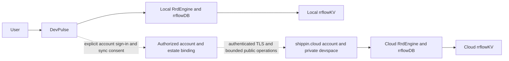

# DevPulse local engine and optional shippin.cloud synchronization

**Status:** active integration contract; local native database path exists, account synchronization is not implemented
**Coordinate:** `rrflow://rrflow-instance/data/reference/client/devpulse-cloud`
**Owner:** DevPulse local-first operation and explicit cloud-account integration boundary

DevPulse will include the local RRFlow reasoning engine and its native rrflowDB.
Installation, local queries, durable writes, recovery and local reasoning that
uses an installed model must not require a shippin.cloud account. Hosted model
calls remain separately authorized provider capabilities. The
[local integration guide](../sdk/rrflowdb-local.md) provides a runnable native
database path now. It is not yet a packaged DevPulse application.

## Relationship and authority

Solid arrows describe local/native engine ownership; the dotted account/sync
path is a required future integration. Account and workspace grouping remain
outside the engine as defined by the [instance topology](../../architecture/instance-topology.md).
Each endpoint authenticates an exact instance. A cloud account, UI or resolver
cannot become a database authorization or lifecycle authority. Separate local
and cloud instances do not imply an active-active replica or cross-instance ACID.

## Required user behavior

1. Start and use the local project without sign-in. The initial sync state is
   disabled; there is no account discovery request or background upload.
2. Offer account creation or sign-in at shippin.cloud as an optional action.
   Creating an account alone does not authorize data transfer.
3. Preview the exact local project/estate, remote account and destination
   instance, selected data families, transfer direction, permissions, limits,
   excluded secrets and initial-transfer size. Require explicit sync consent.
4. Establish authenticated transport, verify remote protocol/instance/catalogue
   identities, then activate the authorized adapter binding. Never upload the
   local operator credential, token signing key, model-provider secrets, or raw
   database files as an implicit sync mechanism.
5. Display progress, last acknowledged checkpoint, pending local changes,
   conflicts and paused/offline status. Cloud outage leaves local work usable.
6. Disconnect disables future transfer and revokes adapter credentials. Local
   data is retained; remote deletion is a separate explicit action.

## Required synchronization mechanics

Use the engine's typed public mutation, changefeed and receipt capabilities.
Account authentication and user consent authorize a binding; they are not
themselves a replication algorithm. A future sync package must implement:

- a durable, engine-owned binding naming local instance, remote instance,
  account reference, direction, schema/profile digest, consent revision and
  revocable credential reference;
- an explicit initial snapshot/checkpoint handoff with bounded batches,
  interruption/restart and detectable retention gaps;
- source identity and original commit identity on every batch, an immutable
  content digest and a destination idempotency key derived from those identities;
- destination authorization and schema/constraint validation through
  `RrdEngine`; ACK only after the destination's durable receipt, and checkpoint
  advancement only after validating that receipt;
- replay deduplication and origin tracking so a downloaded commit cannot echo
  back as a new local change;
- tombstone/delete propagation, schema incompatibility denial and explicit
  rebootstrap when the source checkpoint is no longer retained;
- optimistic base-version conflict detection; concurrent edits produce a
  visible conflict and an explicitly authorized resolution, not clock-based
  silent overwrites; and
- pause/revoke races, account switching, wrong destination, token expiry,
  tampering, quotas and slow/offline receivers with bounded retry/backpressure.

The current native snapshot-isolation transaction model and changefeed do not
by themselves satisfy these requirements. There is no shippin.cloud account
endpoint, sync binding, cross-instance reconciliation implementation or
production credential configured by this package. Cloud code execution and
private UI previews for Rust/Python/Go need their own isolated devspace service;
they must not execute inside the database process.

## Delivery and acceptance

[D-01/D-06](../../roadmap/rrflow-1.0/gate-d.md) own installed local operation and
explicit adapter activation. [H-04/H-07](../../roadmap/rrflow-1.0/gate-h.md) own
public client/account endpoint integration. [POAM-011](../../poam/rrflow-1.0-alpha/poam-011.md)
tracks the absent cloud integration, and [Gate J](../../roadmap/rrflow-1.0/gate-j.md)
owns distributable platform evidence. No gate is closed by this design.

Qualify a packaged DevPulse build with no network/account; restart it and prove
local records/relations unchanged. Then use two installed engines and a real
account service to prove opt-in transfer, initial snapshot plus live changes,
idempotent reconnect after lost ACK, concurrent-edit conflict, deletes,
schema changes, source retention gap, foreign-account denial and revocation
during a transfer. Restart both ends at each durable handoff. Finally repeat
against a real shippin.cloud private devspace. A mock account, copied files,
green HTTP status, or local two-process demo is not cloud-sync acceptance.
