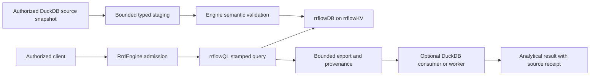

# DuckDB interoperability with rrflowDB

**Status:** active target contract; DuckDB support is unimplemented and unqualified
**Coordinate:** `rrflow://rrflow-instance/data/reference/data/duckdb`
**Owner:** optional DuckDB analytical exchange and execution boundary

rrflowDB remains the Rust-native semantic database over rrflowKV. DuckDB is
an optional analytical consumer or source, never the estate's transaction,
receipt, authorization, recovery or readiness authority. The existing
[Parquet export](knowledge-connectors.md#bundled-query-export) is the starting
exchange boundary. Its existence does not establish DuckDB compatibility.
[Gate D](../../roadmap/rrflow-1.0/gate-d.md#duckdb-interoperability-packages)
owns implementation order and acceptance; [C-07](../../roadmap/rrflow-1.0/gate-c-07.md)
continues first. This contract does not replace Gate F's DataFusion work or
H-08's PostgreSQL server compatibility.

## Decision and alternatives

The first profile consumes an explicitly shared, authenticated rrflowDB
query-result export in a pinned real DuckDB client. Next, a separately
authorized source profile reads a consistent DuckDB export or read-only
database snapshot and proposes canonical mutations. Optional bundled query
execution follows only after isolation, resource and distribution proof.
Each direction has its own activation, permissions and acceptance receipt.
Neither direction implies synchronization or cross-database atomic commit.

| Option | Decision and consequence |
|---|---|
| Export interoperability first | Selected first: reuses a bounded supported operation and permits real typed-value comparison without adding a database to default readiness. Export is a snapshot, not a live federated table. |
| Link DuckDB directly into the canonical query executor | Deferred: native code and allocations would share the engine's failure domain, and its SQL/settings could bypass RRFlow policy without an admitted adapter. It cannot replace the planned stamped DataFusion provider. |
| Optional owned analytical worker | Target for bundled execution: first-party Rust adapter, pinned third-party runtime, engine-owned lifetime and receipts. Native isolation and aggregate budgets must be proven before untrusted SQL or files become available. |
| Replace rrflowKV with DuckDB or attach live storage files | Rejected: changes canonical durability, transaction and physical-format authority and cannot satisfy the native-engine requirement. |

DuckDB's Rust client wraps its C API; using that crate does not make DuckDB
a pure-Rust database. Bundled compilation is a third-party build input, not
permission to download a library or extension during installation or execution.
Select one exact engine/client version, license, features, native toolchain
and source digest in the implementation PR. Build and test that same set on
every declared native platform. Preserve the existing Arrow 59.2.0 boundary;
if the selected binding uses another Arrow ABI/version, use qualified IPC or
Parquet exchange rather than transmuting buffers or forcing unrelated upgrades.
[DuckDB Rust client](https://duckdb.org/docs/current/clients/rust/overview).

## Governed data path

Export consumers verify the artifact SHA-256, profile and embedded source
metadata before interpretation. Preserve identity, scope, read-manifest digest,
known cursor, schema revision, authorization identity, column types and
nullability. A derived result retains the source receipt plus exact DuckDB
version, query/parameter digest and limits. Metadata is provenance, not a grant
to disclose an export or to read another estate. An exported snapshot stays at
its declared cursor; it must never be relabeled current after later mutations.

The initial conformance corpus covers empty results, nulls, booleans, signed
and unsigned integer extremes, decimal precision/scale, Unicode, digests,
lists/maps/mixed values and reserved identity columns. Specify each mapping
explicitly: logical values encoded by RRFlow metadata cannot silently become
ordinary strings or lossy floating-point numbers. Unsupported values produce
a typed denial. Compare ordered identities and values against the independent
requested fixture, not against a second read through the same decoder.

Source import requires a previewed binding to an immutable digest or an
explicitly qualified consistent source snapshot. A live file copy is not a
snapshot: source WAL, concurrent writes, checkpointing and file-lock semantics
must be resolved by the source owner. Initial native-file access is read-only
and excludes a concurrently writing process; lock conflicts are reported with
a finite deadline. Native in-process DuckDB supports one read-write process
or read-only processes. Remote protocols and lake catalogues are different
profiles and are not implicitly activated. [DuckDB concurrency](https://duckdb.org/docs/2.0/connect/concurrency).

Imported tables use explicit source/table/column mappings, source row identity,
revision and ACL/freshness evidence. Stage within bounds, then admit mutations
through the existing engine transaction path. Persist a source checkpoint and
idempotency identity with each accepted bounded group. Repeating a group after
lost acknowledgement must not duplicate records, relations or index deltas.
Schema drift, deletion and replacement snapshots have explicit handling;
append-only imports must not be advertised as bidirectional synchronization.

## Configuration, effects and resource limits

Extend the existing executable capability catalogue and endpoint-binding
contracts; generate SDK, CLI/MCP and Connectome projections from those types.
Do not add a parallel DuckDB plugin registry. Discovery is inactive and preview
does not open a database, execute SQL or probe a network. Configuration binds:

- profile/version and implementation/artifact digests; export, source-read,
  import or analytical-execute effects separately;
- exact allowed source/artifact identities, schema mapping and freshness;
- memory reservation, process cap, thread count, deadline, input/output bytes,
  rows, concurrent jobs, queue bytes/count, temporary disk cap and retention;
- native containment policy, secret references where applicable, cancellation,
  recovery and ownership-safe removal; and
- capability availability with a precise unsupported, unconfigured, denied,
  unhealthy, busy or resource-exhausted reason.

For a bundled worker, external access, automatic extension installation/loading
and ambient credential discovery default off. Only required pinned extensions
may ship in the reviewed artifact. Initialize allowlisted input/temp access,
then lock security and resource configuration. Caller SQL cannot change limits,
attach arbitrary files, install code, obtain credentials or escape the declared
effect. Parameters protect values only; accepting SQL itself requires separate
admission and native isolation. File allowlists are not a substitute for
handle/path containment. [DuckDB security](https://duckdb.org/docs/2.0/operations_manual/securing_duckdb/overview).

DuckDB's buffer-manager memory limit is not a hard whole-process bound.
Charge engine-held export buffers, IPC, worker private memory, retained results
and temporary files; measure aggregate RSS independently. Admission precedes
materialization. Cancellation or deadline interrupts work, terminates/reaps an
unresponsive owned worker within a finite grace period and releases reservations
only after owners are gone. Native worker failure must leave rrflowKV available
and produce no partial canonical publication. Unavailable enforcement means
the profile is unavailable on that platform. [DuckDB limits](https://duckdb.org/docs/current/operations_manual/limits).

Parquet projection/filter pushdown may reduce input work but cannot grant
access to excluded rows or columns. Apply RRFlow authorization before exchange;
measure scan/decode/output and compare exact results with pushdown disabled.
No zero-copy, speed or capacity claim follows from format compatibility.
[DuckDB Parquet](https://duckdb.org/docs/2.0/data/parquet/overview).

## Qualification and updates

Retain exact binary/source/build identities, case manifest, seeds, native
platform, expected values, errors, resource traces and reopen receipts.
Required cases include wrong digest/profile/scope, stale authorization,
unsupported types, malformed/truncated input, memory/spill/output pressure,
SQL configuration/extension/file escape, worker death, cancellation, source
lock conflict, duplicate import, lost response and restart. Two estates must
remain isolated. An external client fixture proves only interoperability;
bundled execution additionally needs offline signed-bundle and native sandbox
proof. Connectome may display the planned integration, but must not advertise
it as executable until the corresponding profile is qualified.

Updates rebuild a pinned compatibility set and run the same corpus before
distribution. No native hot-swap, shared mutable extension directory, runtime
fetch or implicit activation is permitted. Remove only owned bindings and
temporary/derived artifacts; retain canonical rrflowDB data and project-owned
DuckDB sources. Existing receipts remain interpretable after retirement.

Primary documentation was reviewed on 2026-10-22 UTC. Stable documentation
redirected to the 2.0 manual while Rust-client search results named another
version; this plan deliberately does not infer a tested compatible version.
No upstream code was copied or vendor benchmark adopted. The open implementation
gap is [POAM-036](../../poam/rrflow-1.0-alpha/poam-036.md).
