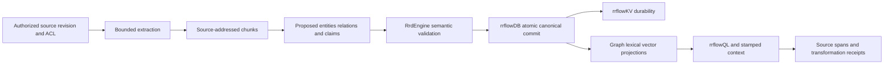

# Knowledge-tree connectors and governed knowledge construction

**Status:** active target contract; advanced connector lifecycle and pipeline are unimplemented
**Coordinate:** `rrflow://rrflow-instance/data/reference/data/knowledge-connectors`
**Owner:** AI-discoverable knowledge connector requirements, provenance, chunking, and Parquet exchange boundary

A knowledge-tree connector is an optional adapter that exposes a navigable
source hierarchy and typed retrieval/ingestion capabilities. The hierarchy is
a view over source and relationship records, not a new database or authority.
Cross-links can form a graph; traversal must bound depth, fan-out, bytes and
cycles. The [rrflowDB capability record](rrflowdb-capability.md) owns canonical
graph families and project links. The
[schema catalogue](schema-catalogue.md#structure-and-input-contract-plan) owns
schema generation and validation. D-06 owns activation, D-05 owns ingestion,
H-09 owns family formation, H-10 owns project links, and H-04 owns client parity.

**Knowledge path** is the user-facing name for a project-scoped binding to an
external database or knowledge/reasoning service through such an adapter.
It is a specialization of the existing connector boundary, not another plugin
registry, database or executable type. Connecting HydraDB, Pinecone Nexus,
Qdrant or SurrealDB must preserve that source's actual supported profile and
provenance. A configured path does not authorize import, cross-project sharing
or background learning. The engine may propose project profile enrichment
from admitted evidence; accepting a profile revision remains a separate effect.

## AI-readable requirements and availability

Extend the existing executable operation/capability catalogue and
`EndpointBinding`. Do not add a handwritten plugin registry or a second schema
service. Generate the same descriptions, JSON Schema/OpenAPI, SDK types,
CLI/MCP discovery and Connectome forms from canonical Rust types.

| Description | Required machine-readable information |
|---|---|
| Identity | Capability id/version, implementation and schema digests, supported protocol/profile, provenance and compatible engine versions. |
| Inputs and outputs | Closed effect types, bounds/units, example fixtures, declared modalities, pagination, source identity, result provenance and typed errors. An unfamiliar description is inert until a supported effect type admits it. |
| Requirements | Required endpoint class/capabilities, artifact/runtime, credential field requirements and secret references, resource/egress permissions, sandbox enforcement, retention/residency and cost ceilings. Secrets never enter discovery output. |
| Effects | Read, local canonical write, external write, provisioning, or model execution; idempotency, cancellation and uncertain-result semantics; verification and ownership-safe removal. A “read” may still disclose a prompt to a remote vendor. |
| Availability | Distinguish implemented support, installed bytes, configured binding, authorization, observed health and current admission. Include bounded reason codes and observation expiry. Missing credentials, disabled policy, unsupported version, unhealthy endpoint and exhausted quota are different states. |
| Knowledge behavior | Enumerate/read/query/import/export/change/delete capabilities separately; ACL fidelity, snapshot/checkpoint consistency, provenance completeness, tombstones, retry bounds and supported synchronization directions. Unsupported features are explicit. |

Capability discovery is authenticated and filtered to the caller. Availability
is an observation, not a durable permission token; admission rechecks it at
execution. The UI must not show an executable “available” action just because
a schema or provider name exists.

AI-assisted setup follows discover -> inspect requirements -> propose exact
configuration -> preview effects/cost -> authorized apply -> verify -> report.
The existing install/configure mechanism owns durable state and receipts.
Validation/preview performs no external probe; a probe is its own authorized
bounded operation. AI can fill nonsecret fields and explain missing
requirements. Credentials use the configured secret provider, not prompt text,
argv, graph records or logs. Activation and retirement survive restart and do
not silently enable background ingestion.

First-party adapter code and all default runtime assets stay in this repository
and the acquired bundle. An optional external plugin needs an admitted
execution boundary, pinned artifact and declared sandbox; a manifest does not
authorize loading arbitrary native code into the engine. If the promised
sandbox or permission cannot be enforced, activation is unavailable.

MCP tool schemas are a useful outward projection; tool descriptions and
annotations cannot grant authority. The adapter must negotiate its supported
protocol revision and preserve RRFlow authentication, limits, receipts and
errors. A frontier model uses the same supported tools as any client; there
is no provider-specific lifecycle hook. [MCP tool specification](https://modelcontextprotocol.io/specification/2025-11-25/server/tools).

## Knowledge construction and breadcrumbs

All nodes below are semantic roles to be implemented through the existing
source, evidence and knowledge families, not newly implemented type names:

- Source identity includes connector/external-account scope, stable resource
  id, revision/content digest, media type, source ACL/policy revision, observed
  time and retention/deletion obligations. Equal bytes in different estates
  do not merge authorization or expose a global deduplication oracle.
- Chunk identity binds source revision, exact locator (text span, page/region,
  table/row, code range, or media interval), extraction/chunking revision and
  content digest. Preserve parent/section and adjacency links. Encoded,
  decompressed, pixel/frame/duration/token and aggregate limits apply before
  materialization; unsupported media is reported, never silently skipped.
- Entities, relations, claims and summaries retain supporting chunk references,
  extractor/model/prompt/configuration identity, confidence or unresolved state,
  valid/observation times and verification outcome. Extraction creates a
  proposal; it does not turn model output into verified fact.
- Embeddings bind chunk/version, exact model and embedding-space identity,
  dimensions/normalization and the canonical collection/named-vector address.
  Graph, lexical and vector projections record their source cursor and build
  identity. Stale projections cannot present themselves as fresh.
- A context result identifies the exact canonical/foreign source revisions,
  transformations and read stamps used. A tree breadcrumb must open the
  supporting evidence, subject to current authorization; a label or generated
  summary alone is not provenance.

Commit a bounded coherent group of canonical records, relations, source deltas,
receipt and outbox atomically. Large corpora use durable checkpointed jobs;
partial staging is not query-ready publication. Repeating a source revision
must not duplicate accepted facts or external effects. Reprocessing creates
a new derived revision and explicit supersession; old evidence remains
interpretable within authorized retention.

Deletion or ACL change invalidates descendant chunk/summary/context eligibility
and queued work before subsequent serving. Filter before graph expansion,
ranking and context assembly, including cached results. If an adapter cannot
observe current ACLs/deletes, declare its bounded freshness lease and stop
serving on expiry; never promise immediate revocation from periodic polling.
Remote failure, missing provenance, partial results and unsupported snapshot
semantics remain visible. Do not invent a local `ReadStamp` for an unversioned
remote response.

Start with reproducible structure-aware bounded chunking and a simple fixed
window baseline. Evaluate hierarchical, contextual or late chunking as
replaceable configured strategies, not universal improvements. Use held-out
tasks across code, prose, tables and media, with equal retrieval token budgets,
supported citations, answer quality, multi-hop recall, stale/denied leakage,
indexing cost and update cost. Graph summaries must not amplify untrusted
source instructions into permissions.

## Graph and retrieval baselines

This is a target acceptance contract; no baseline-management operation is
implemented by this document. Implement it through the existing engine-owned
versioned evidence, configuration, projection and job boundaries. Generate
public operations and client models from their canonical types when admitted.

A baseline captures the evidence needed to compare a proposed change, rather
than copying an unbounded estate or freezing a user's permissions forever:

| Coordinate | Required retained identity |
|---|---|
| Project and reads | Exact estate/instance, relevant committed project inventory, read stamp, schema revision and source manifest/checkpoints. An unversioned foreign response is explicitly non-reproducible. |
| Knowledge construction | Source/chunk/claim locators and digests; extraction, chunking and graph-family definitions; model/template identities; accepted corrections and projection build/source cursors. |
| Retrieval | Query/task corpus and split digests, embedding space, index/artifact revisions, filtering/fusion/reranking policy, eligible models and effective configuration. |
| Evaluation | Verifier/rubric versions, expected facts/relations/citations, budgets, hardware/runtime profile, measurements and uncertainty. Freeze acceptance thresholds before examining candidate test results. |
| Retention | Required retained artifacts and evidence, expiry, pin/lease owner, storage budget and cleanup policy. Metadata references alone do not guarantee replay availability. |

Bind the baseline to one coherent published state. Concurrent source updates
cannot produce a silently mixed snapshot. Immutable foreign revisions may be
retained only when authorized; otherwise record the limitation and reject an
exact-replay claim. Retention expiry, source deletion, unavailable artifacts or
incompatible readers produce an explicit unavailable or partial result.
Historical authorization is evidence, never a grant: every inspection,
comparison and export must pass current authorization and deletion policy.

Distinguish three operations in the UI and engine:

1. A graph layout/filter change is a bounded presentation preference. It does
   not mutate facts, infer edges, rebuild indexes or change query semantics.
2. A knowledge correction is an authorized canonical mutation with source
   evidence, expected version and receipt. It creates a new revision; a
   historical baseline is not overwritten. Distinguish corrected facts from
   unverified extracted relationships.
3. A graph-building or retrieval-policy change creates a candidate derived
   revision under the admitted build/job mechanism. Compare against the pinned
   baseline before publication; never create a second persistence authority or
   route normal queries to incomplete candidate output.

Run baseline and candidate over the same authorized corpus and budgets. Report
retrieval recall, supported citations, downstream task success, relationship
changes, stale/denied leakage, update cost, p50/p95/p99 latency and peak
resource work, with sample counts and per-family failures. Separate quality
effects from changed source content or model endpoints. Use a fixed retrieval
oracle where possible; model-answer comparisons require repeated evaluations
and reported variation. An authorization violation cannot be traded for a
better aggregate score. Candidate rejection leaves the active revision intact.

Promotion is a separately authorized configuration/projection transition with
expected revision, verified artifact identities and a durable receipt. In-flight
reads retain their original stamp. Rollback selects a compatible prior policy
through a new revision; it cannot undo later source corrections or deletions.
A baseline is not a backup, native restore image or cross-project sharing grant.
Bound concurrent builds, pinned bytes, leases, query work and cancellation;
refuse admission when the estate cannot afford the retained comparison.

Qualification must join connect/import, baseline capture, query/citations,
source edit, candidate rebuild, comparison, promotion/rejection, restart and
readback. Include source ACL revocation, deleted chunks, incompatible embeddings,
expired retention, stale promotion, lost ACK, partial publication and quota
failure. Historical evidence must remain interpretable when retained and
authorized, while current results use the accepted current revision. D-05/D-06,
E/F, H-02/H-09 and H-06 own their respective parts; the
[dependency spine](../../roadmap/rrflow-1.0/executable-dependency-spine.md#project-to-learning-acceptance-journey)
binds the joined acceptance journey. This adds no gate-completion claim.

## Parquet and external knowledge services

Apache Parquet is a columnar interchange/analytical artifact format, not
rrflowKV's WAL or transactional store. `rrd-query` pins DataFusion 55 and the
matching Arrow/Parquet 59.2.0 family. The bundled query-result export below is
the first implemented exchange profile; arbitrary-file import and streaming
exchange remain open.

A governed adapter must pin its reader/writer and supported logical types,
encodings and compression; map schemas explicitly; bind authorized immutable
file/object versions and checksums; and bound footer metadata, row groups,
nesting, dictionary/decompression, bytes, memory, spill and output. Statistics
are pruning hints, not authorization. Missing columns, lossy coercion,
corruption and unsupported types fail explicitly. Imports pass through
canonical mutation validation; exports bind a read stamp and publish only
after the complete artifact/manifest verifies. Interrupted work remains
unpublished. A Parquet file is not a native restore image. [Apache Parquet overview](https://parquet.apache.org/docs/overview/).

### Bundled query export

`query-export` (`POST /v1/query/export`) accepts the usual request envelope
with an `ExportQuery` payload: `query` is an ordinary `ExecuteQuery`, and
`max_output_bytes` is the artifact limit. Session authentication and
`QueryExecute` authorization are mandatory. `RrdEngine` runs the existing
query pipeline once, including tenant/row/field policy, before encoding its
result. The generated catalogue and SDK operations expose this capability to
AI clients. Connectome's dedicated export control is not yet implemented.

The `rrflow-parquet-1` profile has these bounds:

| Property | Admitted profile |
|---|---|
| Rows | At most 1,024; truncated query execution is rejected |
| Columns | At most 64 returned fields plus `__rrd_identity`; that name is reserved |
| Serialized source | At most 256 KiB, including source metadata |
| Artifact | At most 512 KiB and within the request/query/installed output ceiling |
| Row groups | At most 64 rows each, explicitly flushed |
| Encoding | Uncompressed; dictionary and statistics disabled |
| Time | Query and encoding share the query elapsed budget |
| Memory | Conservative admission reservation plus sampled Arrow/writer buffers; no global allocator or streaming qualification |

Existing Arrow field metadata preserves null, boolean, signed/unsigned integer,
decimal, string, digest, list, map and mixed runtime values. Empty results have
only the identity column: this is a returned-value schema, not an export of
the project's schema registry. Source metadata includes canonical query,
instance scope, read manifest, known cursor, schema revision, query plan,
authorization identity and read evidence. Complete bytes are base64 encoded
in the response with a SHA-256 digest. Consumers verify the digest before
decoding. Equivalent exports need not have identical physical bytes.

The codec never accepts a filesystem destination, remote URL or executable.
It returns no artifact on encoding or budget failure. Metadata describes the
authorized result and is not a credential or a grant to another engine.
Sharing the artifact remains a separate explicitly authorized client action.

Apache Parquet is a locked Rust build dependency, not a separately running
daemon or a Git submodule. It ships inside `rrflow`; installation and export
fetch no codec. To update it, review the Arrow/DataFusion/Parquet compatibility
set, change the exact pins and lockfile together, rerun typed round-trip,
resource-denial, authorization and installed restart tests, and pass candidate
CI before distributing a rebuilt bundle. Native hot-swapping is not supported.
Apache documents the writer's row-group buffering and memory estimates.
[Apache ArrowWriter](https://arrow.apache.org/rust/parquet/arrow/arrow_writer/struct.ArrowWriter.html).

The [bounded export journal](../../evidence/change-journals/gate-d/d-06-bundled-parquet-export.md)
records implementation and validation. Full import/export qualification
retains Gate D's malformed-input, decompression, source-binding and Gate F
streaming requirements.

### External knowledge services

DuckDB analytical exchange, source import and optional bundled execution have
a separate [interoperability contract](duckdb.md). Support is not implemented;
the existing Parquet export is its starting boundary, not conformance evidence.
Its ordered packages remain under D-06 and depend on C-07/F as specified there.

HydraDB, Pinecone Nexus, Qdrant and SurrealDB each require a separately implemented and
qualified optional adapter; none is qualified by this document.
Never advertise vendor support from a logo, schema stub or generic HTTP
client. Pin the actual service API/SDK and admitted feature profile when its
implementation starts. Require authenticated real-service tests for each
declared feature, account/resource scoping, rate limits, retries, deletion,
credential rotation and source fidelity. If an API or account is unavailable,
the adapter remains unsupported/unqualified.

The first supported profile should be read-only retrieval with source evidence;
ingestion/export and remote mutations require separate declared effects.
Vendor scores are not comparable probabilities: preserve score semantics and
use a qualified fusion/reranking policy. Canonical RRFlow persistence stays
native. Mesh resolution maps stable instance/service identity to an
authenticated endpoint, never to a globally trusted knowledge pool. Cross-project
reads require H-10 links; bidirectional state transfer remains H-07.

## Research and adaptation decisions

Primary sources inspected on 2026-10-20. These inform RRFlow design choices;
vendor claims and research results are not RRFlow performance evidence. No
upstream code, schema authority or runtime is copied.

| Source | Useful behavior and RRFlow decision |
|---|---|
| [HydraDB CLI](https://github.com/hydra-db/hydradb-cli) and [AI guide](https://hydradb.com/ai) | Machine-readable commands, provider credential requirements, resource discovery/configuration, readiness and asynchronous indexing status inform setup UX. Adapt through D-06/H-04 receipts; do not adopt its installer, account prerequisite or separate graph-store authority. |
| [Pinecone Nexus introduction](https://www.pinecone.io/blog/introducing-nexus-knowledge-engine/) | Task/domain evaluation driving derived artifacts informs bounded curation experiments. Keep source evidence, versioned transformations and acceptance under RRFlow. Product availability claims do not establish an accessible or compatible API. |
| [Qdrant multitenancy](https://qdrant.tech/documentation/manage-data/multitenancy/) | Payload scoping and tiered shard placement illustrate independent logical filtering and physical optimization. The adapter must enforce caller scope; sharding is not project VM isolation or a replacement for RRFlow policy. |
| [Microsoft GraphRAG dataflow](https://microsoft.github.io/graphrag/index/default_dataflow/) | Chunk-to-document and extracted-knowledge references inform provenance. Adapt those relationships into existing RRFlow families, not a second GraphRAG store. |
| [HiChunk / HiCBench](https://arxiv.org/abs/2509.11552), [2026 code chunking study](https://arxiv.org/abs/2605.04763), [2026 academic-text study](https://arxiv.org/abs/2607.01852) | Hierarchical evaluation and differing corpus results argue for task-specific measured choice. Treat these as research candidates; no global best chunk size or algorithm is established. |

## Implementation and qualification

[Gate D](../../roadmap/rrflow-1.0/gate-d.md#connector-and-knowledge-ingestion-packages)
owns bounded discovery/configuration, source provenance and Parquet packages.
H-09/H-10 consume those outputs. H-05/J-04 require source/update lag,
ingest/extract/index/serve readiness, bytes and amplification, queue/CPU/model
cost, stale/denied results, provenance coverage and fixed-corpus quality.
No raw content or unbounded source IDs in metric labels.

The minimum retained corpus includes changed/deleted/denied sources, duplicate
delivery, lost ACK, restart, wrong account, schema drift, huge/compressed input,
cyclic links, poisoned summaries, expired freshness, and incompatible vector
spaces. Prove both rrflowMX/rrflowKV semantic equivalence and installed rrflowKV
reopen. End-to-end UI and vendor tests are additional requirements; a mock
connector proves only its contract.
