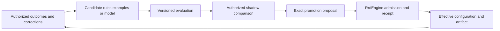

# SWAG training and RROFLOW improvement

**Status:** active target contract; training, evaluation harness and governed promotion are unimplemented
**Coordinate:** `rrflow://rrflow-instance/data/reference/inference/learning/controller-training`
**Owner:** controller dataset, experiment, artifact qualification and improvement boundaries

The [LFG/SWAG contract](../lfg-swag.md) owns runtime behavior. This record owns
how optional controller candidates are developed and evaluated. [Gate G](../../../roadmap/rrflow-1.0/gate-g.md#controller-learning-packages)
owns offline qualification and integration; [Gate I](../../../roadmap/rrflow-1.0/gate-i.md#rroflow-improvement-packages)
owns the RROFLOW improvement routine. The dependency spine remains unchanged.
Preparing an offline experiment does not authorize or qualify runtime effects.

## Fit the existing boundaries

| Major boundary | Required extension and preserved behavior |
|---|---|
| `crates/transport/rrd-contract` | Extend the existing configuration, endpoint, router and model-manifest families. Generate outward schemas and SDKs from the executable catalogue. Keep endpoint selection separate from the existing three recipe/branch/context proposals. |
| `crates/compute/rrd-inference` | Preserve byte-verified model/tokenizer/runtime/grammar admission. Implement optional LFG and executable SWAG at the existing compute boundary; a training checkpoint cannot bypass admission. |
| `crates/authority/rrd-engine` | Own effective configuration, permission checks, durable state, accepted evidence and promotion receipts. Reuse the generic routine authority for improvement rather than introduce a training scheduler inside Python. |
| `crates/kernel` and `crates/persistence` | Extend canonical semantic values and their existing transaction mapping only when a durable family is specified. No separate learning database or training-owned canonical log. |
| `scripts` | Future first-party offline training/evaluation tools belong under an inference subdirectory, grouped by dataset, experiment and packaging responsibility as executable packages land. Python may run here or through an explicitly configured external activity. It is not an engine bootstrap or readiness dependency. |
| `docs/reference/inference/learning` | Own this contract and the Spark preparation guide. Reference and journal links provide navigation; no duplicate implementation inventory or roadmap. |
| Connectome public client | Project engine-owned state into configuration, run comparison, experiment and release views. No client-authored lifecycle, direct checkpoint activation or embedded Python trainer. |

Create implementation folders with their first tested implementation and
package journal, not empty placeholders or copied upstream trees. Splitting a
large module requires preserving callers, public exports, validation and
characterization tests in the same bounded package. The present model
admission is useful working behavior; there is no existing training pipeline
to rename, replace or claim as integrated.

## Learning tasks and data

Start with deterministic policies and a simple classifier as baselines.
Compare a small instruction-model candidate on the same corpus before choosing
a training method or size. A controller can be smaller than the models it
selects. New provider bindings need capability and conformance evidence;
transport compatibility alone does not make every frontier or local model
interchangeable.

Keep endpoint-selection targets separate from `RouteStepDecision` training
targets. The existing `RouterModelManifest` binds the latter's schema and
grammar; it is not a generic endpoint-classification manifest. G-01b must
define the appropriate capability before accepting a learned endpoint selector.
Missing analysis, abstention and failure are explicit outcomes at their owning
boundary, not invented fourth route proposals.

Every versioned dataset needs:

- authorized source references, estate and sharing scope, source revision,
  collection purpose and consent, retention and export constraints;
- input/context and effective-configuration identities, task family, eligible
  endpoint/recipe candidates, and declared capabilities as observed then;
- observed choice and outcome, verification result, human correction or
  evaluator identity/revision, with unknown or disputed quality explicit;
- bounded input/output records, secret filtering, duplicate groups, and
  project/time-separated train, validation and held-out test assignments;
- provenance for synthetic examples and teacher-generated outputs, including
  allowed use and independently checked labels; and
- immutable export and split manifests with digests and row/exclusion counts.

Training consent is separate from context sharing and cloud synchronization.
Collecting telemetry does not authorize training on it. Do not read raw estate
storage from Python. Authorized export uses public capabilities; Parquet is
an optional exchange representation under the
[knowledge connector contract](../../data/knowledge-connectors.md).
No dataset exists merely because a prompt flight was recorded.

## Experiments and release

An experiment binds dataset/split digests, base model, tokenizer, prompt
template, objective, hyperparameters, seeds, source revision, dependency lock,
container/runtime/driver/device identities, limits and produced artifacts.
Record resource peaks, wall time, interruption and resume behavior. Exact
bitwise determinism is claimed only if demonstrated; record repeated-run
variation otherwise. Configurable limits and endpoints never imply unbounded
or arbitrary command execution.

Supervised fine-tuning is an initial candidate method. Preference optimization
requires reliable preferences; contextual-bandit experiments must record
selection probabilities and their coverage assumptions. Observing only the
chosen model's outcome cannot establish how unchosen models would have done.
Unsupervised clustering can suggest recurring failure families; it cannot
certify correctness or authorize a deployment.

Evaluate downstream task success, constraint violations, invalid decisions,
abstention, calibration where defined, cost per accepted task and latency
including controller, queue, model and storage time. Freeze acceptance limits
and quality/cost trade-offs before evaluating the held-out test set. Include
out-of-distribution projects, changed providers, stale capabilities, prompt
injection, denied sharing and unavailable models. Report sample counts,
uncertainty and per-family failures. Compare equal budgets and eligible model
sets; no aggregate score can excuse an authorization violation.

Reload the exported checkpoint and repeat evaluation after quantization or
adapter merging. The current model manifest does not admit an unbound LoRA
sidecar: produce fully bound supported bytes, or qualify an explicit manifest
extension before deployment. Bundle required templates and assets with their
digests. A recipe that downloads moving model or package revisions is an
experiment, not a reproducible release.

The dataset and experiment records are evidence. The installed runtime
manifest and effective engine configuration remain the activation authority.
Do not introduce another mutable model registry as a competing source of truth.
H-05 projects causal evidence; Gate J owns signed distribution and competitive
claims. Training success alone satisfies neither.

## RROFLOW improvement and user attunement

The loop uses ordinary engine records, operations and I-03 routines. It does
not create a schema of private thought. Updating a preference, retrieving a
verified exemplar, changing a rule and training new weights are distinct
changes with distinct evidence. User attunement can propose each; it cannot
silently mutate them all.

Promotion binds expected configuration revision, candidate artifact or rule
digest, dataset/evaluation evidence, affected audience, permission and budget.
Explicit operator policy may authorize bounded automatic promotions only
after that profile is qualified; installation enables none. Recheck revocation
before effects, accept the transition with CAS and a durable receipt, and
retain in-flight revision identity. A duplicate receipt cannot deploy twice.
Rollback is a new authorized configuration revision with compatibility checks,
not a history rewrite. Interrupted external training remains unresolved until
the generic activity protocol reconciles it.

Shadow runs require permission and budget for their additional model calls.
Replaying a trace for inspection is distinct from invoking models/tools again;
the latter is fresh governed work and cannot silently repeat project effects.
Observed hops and diagnostic reason codes are evidence, not a provider's hidden
reasoning. Profile provenance and sharing stay under the
[project-preferences owner](../../client/devpulse-cloud.md#project-preferences-sharing-and-isolation).
Local use remains independent of shippin.cloud and training hardware.

## Staged learning and feedback

RROFLOW is layered on qualified project state, source provenance, retained
run evidence and reproducible comparisons. It is not enabled by installing
RRFlow or recording more prompts. The
[graph/retrieval baseline contract](../../data/knowledge-connectors.md#graph-and-retrieval-baselines)
and [Connectome inspection contract](../../client/connectome.md#guided-project-knowledge-and-session-journey)
define the inputs to the eventual user-facing loop. Offline G-06 experiments
may start earlier against independently authorized fixed fixtures; they cannot
claim installed attunement, user adaptation or production benefit.

| Stage | Candidate input and output | Required evidence before the next effect |
|---|---|---|
| Observe and establish a baseline | Authorized outcomes, explicit corrections and retained task/context/configuration identities; versioned evaluation corpus. | Current consent, source validity, secret exclusions and project/time-separated holdout; unknown quality remains unknown. No training consent inferred from inspection or telemetry. |
| Supervised improvement | Independently checked labels or human preferences suggest rules, exemplars or a model candidate. | Dataset/split provenance, label quality and held-out comparison against deterministic/simple baselines. A user correction does not itself activate weights. |
| Unsupervised discovery | Authorized clustering or representation analysis proposes recurring task/failure families and candidate relationships. | Source-grounded review and downstream evaluation; clusters are hypotheses, not verified facts or permissions. Derived graph changes use the same baseline/promotion boundary. |
| Recursive improvement | A bounded I-03 routine proposes, evaluates and optionally shadows a revision using verified outcomes from prior revisions. | Maximum iterations/elapsed time/spend, cancellation, deduplication, restart and uncertain-effect reconciliation. Self-generated evaluations cannot be their sole correctness oracle; preserve independent holdouts and evaluator identities. |
| Promote and monitor | Qualified candidate and exact scope become a proposed configuration/artifact revision. | G-06 qualification where models are involved, I-03 receipt/CAS, explicit policy, regression checks and compatible rollback. No deployment-wide automatic learning by default. |

Reusing a held-out set to tune successive candidates contaminates it. Version
evaluation splits, reserve a final untouched acceptance set and report when
the available evidence cannot support another independent comparison. Track
changes per project/task family, including regressions hidden by aggregate
scores, drift, cost and prohibited access. Candidate history and negative
results remain inspectable subject to retention and current authorization.

The user may accept a preference or verified exemplar without consenting to
training, share context without exporting datasets, or synchronize a project
without activating RROFLOW. Connectome projects those separate engine-owned
states. Optional rrflow.ai/rroflow.ai access and shippin.cloud integration use
the [managed-service boundary](../../client/devpulse-cloud.md#optional-managed-service-roles);
none becomes a second learning scheduler, canonical log or mandatory login.

## Research decisions

Sources were reviewed on 2026-10-20; applicability must be rechecked when an
implementation package selects a method. These are experimental inputs, not
RRFlow performance claims or copied implementations.

| Primary source | Useful hypothesis and required caution |
|---|---|
| [RouteLLM](https://arxiv.org/abs/2406.18665) | Preference-labelled routing baseline; evaluate actual RRFlow tasks and total controller cost. |
| [Arch-Router](https://arxiv.org/abs/2506.16655) | Domain/action preference routing with changing model choices; preference matching is not proof of successful downstream execution. |
| [BaRP](https://arxiv.org/abs/2510.07429) | Partial-feedback, preference-adjustable routing; compare against supervised baselines and account for selection bias. |
| [MetaRouter](https://arxiv.org/abs/2606.06178) | Recent preference adaptation candidate; paper results do not establish production stability or RRFlow transfer. |
| [LLMRouterBench](https://arxiv.org/abs/2601.07206) | Unified evaluations find sophisticated routers can fail to beat simple baselines; require reproducible comparisons and carefully selected models. |
| [Phoenix](https://arize.com/docs/phoenix/) and [Raindrop Workshop](https://www.raindrop.ai/blog/introducing-workshop/) | Public tracing, replay and experiment behavior informs H-05/H-06 projections; reuse the existing task/flight and causal evidence boundaries, not a second event store. |
