# LFG analysis and SWAG controller

**Status:** active target contract; configuration types exist, LFG and SWAG execution are unimplemented
**Coordinate:** `rrflow://rrflow-instance/data/reference/inference/lfg-swag`
**Owner:** configurable CPU prompt analysis, System One selection, model dispatch, and inference-cache identity

The [system overview](../../architecture/system-overview.md#canonical-component-terminology)
owns the names. LFG supplies CPU-derived data points; SWAG is the System One
controller and model gateway. This record defines their boundary before code.
[Gate G](../../roadmap/rrflow-1.0/gate-g.md) owns delivery; the
[endpoint profile](../deployment/endpoint-bindings.md) remains the endpoint
configuration owner. Neither component replaces `RrdEngine`.

The [learning contract](learning/controller-training.md) owns optional
controller training, evaluation and RROFLOW improvement. Its
[Spark guide](learning/spark.md) prepares a training host; it does not change
runtime dependencies or make model execution available.

## Configurable execution

```mermaid
flowchart LR
    Client[Authenticated prompt] --> Engine[RrdEngine admission and budgets]
    Engine --> LFG[Optional CPU analysis]
    LFG --> Signals[Versioned observations]
    Engine --> SWAG[Configured SWAG policy]
    Signals --> SWAG
    SWAG --> Proposal[Selection or context proposal]
    Proposal --> Check[RrdEngine validation and authorization]
    Check --> Binding[Admitted endpoint and adapter]
    Binding --> Result[Observable result and usage]
    Result --> Commit[RrdEngine receipt and durable transition]
```

This is the target flow. Exploratory reasoning remains adaptive under
[ADR-0002](../../decisions/0002-adaptive-reasoning-governed-effects.md).
Persistence, external calls, replay and claimed evidence bind the relevant
read/source identity, authorization and budgets. There is no schema of thought.

| Boundary | Required contract and behavior |
|---|---|
| LFG input | Bounded authorized prompt/modal references and requested analyses; source digest, analyzer/configuration revision, deadline and CPU/memory/input/output limits. It receives only fields needed for analysis. |
| LFG output | Versioned observable features such as complexity, language, modality and task category; explicit units/ranges, provenance, missing/inconclusive/error states, and confidence only when its meaning and calibration are declared. No invented confidence, permissions, model dispatch or mutation. |
| LFG implementation | CPU-first optional adapter. Deterministic rules are admissible; a learned classifier is optional and requires a pinned manifest and measured resource/quality evidence. Do not require a trained model merely to qualify deterministic analysis. |
| SWAG policy | Installed revision selects among authorized endpoint candidates using required modalities, context/output capacity, locality/data residency, quality floor, price ceiling, latency deadline and observed health. LFG observations are optional inputs, never authorization. Unknown/stale price or capability cannot satisfy a hard requirement. |
| SWAG proposal | Observable selected binding/model identity, configuration revision, bounded reason code, accepted input/context identity and budget estimate. Existing `RouteStepDecision` remains the separate three-proposal union for recipe, branch and context intent. Model endpoint selection is not a fourth route decision. |
| Dispatch | SWAG performs the gateway role through an engine-admitted inference call. The engine rechecks binding revision, identity, egress, permission and remaining budget before invoking the adapter. The gateway cannot dispatch an arbitrary URL or create a second durable scheduler. |
| Result | Model/runtime/configuration identity, response/usage references, elapsed/queue time, outcome and receipt. Unavailable usage is explicit, not zero. Reasoning-tree/job transitions and accepted result replay remain engine-owned. |

Define the LFG Answer/Address values at the existing kernel/public boundaries
before G-01b implementation, consistent with the
[classification family](../data/rrflowdb-capability.md#prompt-graph-families).
The existing router manifest is for an actual model-backed adapter, not proof
that LFG contains a model. Preserve its admission tests when assigning the
router execution port to the SWAG path.

## Configuration revisions and failure behavior

Extend the existing `EstateConfiguration` and `EndpointProfile` revision
mechanisms; do not add a mutable provider-owned configuration file. Defaults,
project preferences and per-request overrides produce one effective digest
with field origins. Hard policy intersects all applicable limits; an override
may narrow authority, never widen it. Changing a preference cannot activate
a connector, buy a service, grant sharing, or install model bytes.

Preview the exact proposed revision, changed capabilities, credentials by
reference, model/artifact digests, permissions and resource/cost limits.
Authorized apply uses expected revision/CAS and a durable receipt. In-flight
work retains its bound revision; policy revocation is checked at each next
effect. Rollback creates a new authorized revision. A disabled LFG reports
unavailable observations; SWAG may use a separately qualified policy that does
not require them. Missing required analysis causes abstention, not fabricated
signals. Disabling SWAG leaves explicit authorized model bindings usable.

The ordered profile fallback list is a candidate list, not permission to send
data to every provider. Each fallback must independently satisfy locality,
modality, quality, cost and authorization. Retry only within one remaining
budget and after classifying the previous outcome. A timeout after dispatch
does not prove the provider did no work; record uncertainty and avoid an
unapproved duplicate charge or external effect. Cancellation must account for
work still running, including CPU work that cannot be immediately stopped.

## Cache identity and sharing

Model KV cache is disposable inference acceleration. It is not rrflowKV,
durable recall, a portable memory format or a substitute for source provenance.
Different models/tokenizers/adapters/runtimes may have incompatible tensors.

The gateway must derive an opaque cache scope from authenticated estate and
principal authorization, explicit cache-sharing consent, policy epoch and
endpoint/model revision. Default reuse stays within the authorized principal
and estate. Broader reuse needs a separately approved trust group; a project
link, common account or co-located VM does not grant it. Mixed-scope context
must satisfy every source's permitted audience or disable reuse.

The exact cache key additionally binds model weights, tokenizer, prompt
template, adapter/LoRA, runtime/cache format, ordered token prefix, multimodal
content/processor identity and relevant configuration. Finalize its canonical
encoding and digest in the owning Rust contract, with golden tests; this
document does not invent a public header or executable wire format.

Transport metadata may carry an opaque engine-issued scope, request correlation
and configuration identity. Strip or reject client-supplied authority headers.
Adapters map the scope only to a verified provider capability: vLLM documents
`cache_salt` for partitioning prefix reuse. A header name alone provides no
isolation. An adapter with no demonstrated isolation must disable shared
caching or require an independently isolated backend; it cannot report
isolation as available. See [vLLM security guidance](https://docs.vllm.ai/en/latest/usage/security/).

Revocation changes the policy epoch, denies subsequent cache access and
invalidates derived context eligibility. Eviction/deletion acknowledgements
are distinct from denial; do not promise erasure from a remote backend without
evidence. Secrets and raw prompts are excluded from cache logs and metric
labels. Provider caches can remain opaque: report unsupported or unknown
instead of manufacturing cache hits or cross-provider portability.

## Acceptance and signals

G-01/G-03 must prove analysis-disabled, inconclusive, malformed, oversized,
stale-revision and CPU-exhaustion behavior; deterministic analysis has a fixed
corpus, learned analysis additionally reports calibrated quality on held-out
data. G-02/G-04 prove governed dispatch and durable replay. G-06 compares
policies on the same task/corpus/model inputs, including abstention and routing
regret against the measured eligible choices.

Cache tests pair identical prefixes across principals, estates and policy
epochs, forge caller metadata, change model/LoRA/media, revoke shared context,
and exercise an unsupported provider. Require same-scope reuse where supported,
no cross-scope reuse, and no stale authorized output after revocation. A
statistical timing test supplements these structural checks; it cannot prove
all side channels absent. Cache transport conformance is adapter-specific.

H-05 projects bounded reason/outcome labels and CPU/queue/model/storage time,
tokens, spend, cancellation/late work, cache hit/miss/unsupported and eviction
through the existing signal catalogue. Request or prompt IDs belong in
controlled evidence, not unbounded metric dimensions. J-04 qualifies quality,
latency and cost claims; this record establishes none.
