# LFG analysis and SWAG controller

**Status:** active target contract; configuration types exist, LFG and SWAG execution are unimplemented
**Coordinate:** `rrflow://rrflow-instance/data/reference/inference/lfg-swag`
**Owner:** configurable CPU prompt analysis, System One selection, model dispatch, and inference-cache identity

The [system overview](../../architecture/system-overview.md#canonical-component-terminology)
owns the names. LFG supplies CPU-derived data points; SWAG is the System One
controller and model gateway. This record defines their boundary before code.
[Gate G](../../roadmap/rrflow-1.0/gate-g.md) owns delivery; the
[endpoint profile](../deployment/endpoint-bindings.md) remains the endpoint
configuration owner. Neither component replaces `RrdEngine`.

The [learning contract](learning/controller-training.md) owns optional
controller training, evaluation and RROFLOW improvement. Its
[Spark guide](learning/spark.md) prepares a training host; it does not change
runtime dependencies or make model execution available.

## Configurable execution

```mermaid
flowchart LR
    Client[Authenticated prompt] --> Engine[RrdEngine admission and budgets]
    Engine --> LFG[Optional CPU analysis]
    LFG --> Signals[Versioned observations]
    Engine --> SWAG[Configured SWAG policy]
    Signals --> SWAG
    SWAG --> Proposal[Selection or context proposal]
    Proposal --> Check[RrdEngine validation and authorization]
    Check --> Binding[Admitted endpoint and adapter]
    Binding --> Result[Observable result and usage]
    Result --> Commit[RrdEngine receipt and durable transition]
```

This is the target flow. Exploratory reasoning remains adaptive under
[ADR-0002](../../decisions/0002-adaptive-reasoning-governed-effects.md).
Persistence, external calls, replay and claimed evidence bind the relevant
read/source identity, authorization and budgets. There is no schema of thought.

| Boundary | Required contract and behavior |
|---|---|
| LFG input | Bounded authorized prompt/modal references and requested analyses; source digest, analyzer/configuration revision, deadline and CPU/memory/input/output limits. It receives only fields needed for analysis. |
| LFG output | Versioned observable features such as complexity, language, modality and task category; explicit units/ranges, provenance, missing/inconclusive/error states, and confidence only when its meaning and calibration are declared. No invented confidence, permissions, model dispatch or mutation. |
| LFG implementation | CPU-first optional adapter. Deterministic rules are admissible; a learned classifier is optional and requires a pinned manifest and measured resource/quality evidence. Do not require a trained model merely to qualify deterministic analysis. |
| SWAG policy | Installed revision selects among authorized endpoint candidates using required modalities, context/output capacity, locality/data residency, quality floor, price ceiling, latency deadline and observed health. LFG observations are optional inputs, never authorization. Unknown/stale price or capability cannot satisfy a hard requirement. |
| SWAG proposal | Observable selected binding/model identity, configuration revision, bounded reason code, accepted input/context identity and budget estimate. Existing `RouteStepDecision` remains the separate three-proposal union for recipe, branch and context intent. Model endpoint selection is not a fourth route decision. |
| Dispatch | SWAG performs the gateway role through an engine-admitted inference call. The engine rechecks binding revision, identity, egress, permission and remaining budget before invoking the adapter. The gateway cannot dispatch an arbitrary URL or create a second durable scheduler. |
| Result | Model/runtime/configuration identity, response/usage references, elapsed/queue time, outcome and receipt. Unavailable usage is explicit, not zero. Reasoning-tree/job transitions and accepted result replay remain engine-owned. |

Define the LFG Answer/Address values at the existing kernel/public boundaries
before G-01b implementation, consistent with the
[classification family](../data/rrflowdb-capability.md#prompt-graph-families).
The existing router manifest is for an actual model-backed adapter, not proof
that LFG contains a model. Preserve its admission tests when assigning the
router execution port to the SWAG path.

## Configuration revisions and failure behavior

Extend the existing `EstateConfiguration` and `EndpointProfile` revision
mechanisms; do not add a mutable provider-owned configuration file. Defaults,
project preferences and per-request overrides produce one effective digest
with field origins. Hard policy intersects all applicable limits; an override
may narrow authority, never widen it. Changing a preference cannot activate
a connector, buy a service, grant sharing, or install model bytes.

Preview the exact proposed revision, changed capabilities, credentials by
reference, model/artifact digests, permissions and resource/cost limits.
Authorized apply uses expected revision/CAS and a durable receipt. In-flight
work retains its bound revision; policy revocation is checked at each next
effect. Rollback creates a new authorized revision. A disabled LFG reports
unavailable observations; SWAG may use a separately qualified policy that does
not require them. Missing required analysis causes abstention, not fabricated
signals. Disabling SWAG leaves explicit authorized model bindings usable.

The ordered profile fallback list is a candidate list, not permission to send
data to every provider. Each fallback must independently satisfy locality,
modality, quality, cost and authorization. Retry only within one remaining
budget and after classifying the previous outcome. A timeout after dispatch
does not prove the provider did no work; record uncertainty and avoid an
unapproved duplicate charge or external effect. Cancellation must account for
work still running, including CPU work that cannot be immediately stopped.

## User-selected effort and run budgets

Users must be able to choose how long the engine may work. A request for a
short answer cannot silently become hours of research, repeated planning or
provider retries. This is a required runtime behavior under G-01/G-02/G-05;
it is not implemented by the existing configuration types alone.

The current `ReasoningLimits` exposes `max_run_elapsed_ms`, `max_steps` and
`max_step_elapsed_ms`. Installation validates and seals these values, and
capabilities report them, but `governed-reasoning-runner` remains unavailable.
The shipped values are 900,000 ms, 256 steps and 60,000 ms per step. Their
existence is not evidence of an enforced 15-minute reasoning timeout. The
[installed configuration boundary](../deployment/installed-lifecycle.md#reasoning-limit-configuration)
explains what an operator can configure today.

The current embedding execution path consumes `max_step_elapsed_ms`:
`RrdEngine::generate_embeddings_at` binds one monotonic deadline before input
preparation and passes it to `EmbeddingExecution::embed_batch_until`.
Caller waiting and output acceptance are bounded; a late result is discarded.
The existing single execution permit stays with a blocking adapter until it
returns. A timeout reports that execution may continue and is not automatically
retryable. This is not forced adapter cancellation, a durable run limit or an
implemented SWAG runner. Other calls cannot inherit a fictitious unused budget.

Embedded callers may use `generate_embeddings_with_cancellation` with an
`EmbeddingCancellation` handle. It shares the ordinary generation path's
authorization, installed deadline, validation and admission; it cannot extend
the ceiling. Cancellation is sticky across clones and is checked before
dispatch and output acceptance. A waiting caller checks the signal in blocking
waits of at most 10 ms; host scheduling can add latency. That is not a hard
real-time termination guarantee.

`EmbeddingBackend::embed_batch_controlled` supplies adapters with immutable
deadline/cancellation checks. Its default preserves native batching and checks
before and after the synchronous call. The bundled FeatureHash implementation
also checks during token processing and hashing, between inputs and around
normalization. Individual bounded string/vector operations are not preempted.
A non-cooperative adapter, including the current FastEmbed call, retains its
slot until return even after the caller receives a cancellation outcome.
There is no public daemon Stop operation, persisted cancellation receipt or
Connectome Stop control yet; those require the durable run owner below.

### Research decisions for budget enforcement

Primary-source review on 2026-10-23 supports these separate mechanisms:

- [Tokio timeout](https://docs.rs/tokio/latest/tokio/time/fn.timeout.html) and
  [blocking task ownership](https://docs.rs/tokio/latest/tokio/task/fn.spawn_blocking.html)
  distinguish a stopped wait from stopping non-yielding work. RRFlow therefore
  retains admission for the actual worker and never interprets a timeout as
  provider termination. Hard execution-stop profiles require a qualified
  cooperative adapter or an owned process termination boundary; unsupported
  adapters must be rejected before claiming that guarantee.
- [Temporal activity timeouts](https://docs.temporal.io/encyclopedia/detecting-activity-failures)
  distinguish one attempt from elapsed time across the activity's attempts.
  RRFlow's analogous choice is one original durable run deadline with narrower
  child deadlines. Retry and resume cannot create a new allowance. This is a
  design inference, not adoption of Temporal or its lifecycle.
- [LangGraph recursion handling](https://docs.langchain.com/oss/python/langgraph/graph-api#recursion-limit)
  provides a step ceiling and remaining-step signal. RRFlow must also charge
  individual dispatched attempts and elapsed time: a step counter alone cannot
  stop a single blocked adapter or account for parallel attempts.
- [AWS timeout and retry guidance](https://aws.amazon.com/builders-library/timeouts-retries-and-backoff-with-jitter/)
  explains retry amplification and uncertain effects after a timeout. RRFlow
  keeps one attempt owner, classifies uncertainty, and requires bounded retry
  admission against the same remaining budget. Backoff is not a budget reset.

No external framework, service dependency or upstream implementation is added.
The [Gate G execution sequence](../../roadmap/rrflow-1.0/gate-g.md#budget-control-delivery-sequence)
owns implementation order and the failing histories required for acceptance.

### Aggregate run requirements

#### Embedded task-budget implementation

`RrdEngine::generate_task_embeddings` now binds one task's embedding attempts
to the sealed estate reasoning limits. `TaskEmbeddingAttempt` carries the
existing task ID, stable attempt ID, embedding request and cancellation handle.
It requires both `ReasoningWrite` and `EmbeddingGenerate`; inspection through
`inspect_task_reasoning_budget` requires `ReasoningRead`. These are embedded
Rust methods, not daemon operations or Connectome controls.

The first admitted attempt fixes the configuration digest, original host-clock
deadline and step cap. Each attempt reserves one step before dispatch. The
existing control journal owns the budget and attempt state; the existing
runtime/control transaction atomically commits them with a task-subject evidence
event at the checked runtime cursor. Ordinary project records cannot replace
that control state. Point reads avoid scanning the task's growing history.
Every child deadline is narrowed to the remaining run allowance and step cap;
completed attempts also accumulate conservatively rounded monotonic elapsed
time. Unrelated commit contention may retry completion publication up to three
times, without dispatching another provider call or resetting any allowance.

A repeated attempt never executes automatically. Accepted completion exposes
its result digest; this package does not retain the full embedding result for
replay. An interrupted reservation stays unresolved and blocks further task
attempts. Cancellation or expiry observed before completion publication,
rollback, changed configuration, exhaustion and execution failure stop further
work under that budget. A pending or timed-out
non-cooperative call remains explicitly uncertain; cancellation cannot kill it.
There is no reset, automatic extension, or reconciliation API yet. New attempt
IDs and new sessions do not reset the same task's allowance.

Storage publication is not forcibly interruptible. If publication crosses the
delivery deadline, success is withheld but an accepted receipt can already
exist. That receipt is not erased or re-executed; inspection/replay must account
for it. A recorded terminal stop is distinct from a late response to already
completed work. This is not a durable Stop operation for all task activities.

Host time is explicitly unverified. Any rollback below the last stored
observation stops this budget, even if the estate permits tolerance elsewhere;
unavailable completion time withholds output and retains the reservation.
The original wall deadline survives restart; monotonic child time and charged
elapsed time cover active computation. This does not prove trusted elapsed time
across host suspension, clock manipulation or separate hosts. See the Rust
[clock distinction](https://doc.rust-lang.org/std/time/) and Temporal's
[aggregate and attempt timeouts](https://docs.temporal.io/encyclopedia/detecting-activity-failures).
These sources inform the design; no framework implementation is imported.

The [package evidence](../../evidence/change-journals/gate-g/g-02a-task-budget.md)
separates native rrflowKV reopen/component evidence from installed process-kill
and real-provider qualification. Ordinary standalone embedding calls retain
their per-call limits. Router/context/fallback execution, per-run preference
resolution, cost/token accounting, durable Stop, authorized extension, full
output replay and UI presentation remain open. This is a G-02a prerequisite,
not full aggregate reasoning-run or Gate G acceptance.

Extend that same engine-owned revision and eventual run admission with:

| User control | Required engine semantics |
|---|---|
| Effort selection | Quick, balanced, thorough and custom are editable finite policy presets, not provider names or extra authority. Preview exact resolved limits before submission; the label alone cannot claim a time/cost bound. Thorough or extended work requires the user's selection and never becomes an automatic fallback. |
| Total elapsed time | One deadline starts at run admission and includes queueing, analysis, reads, planning, inference, context escalation, retry delays and validation. A child step inherits the earlier of the run deadline and its step deadline. Internal exploratory work still consumes elapsed time; measuring it does not require recording private thoughts. |
| Steps and attempts | Count each admitted step and each dispatched attempt, including failures, retries, model fallback and repeated context acquisition. A fresh prompt ID, branch, session or worker does not reset the same run's consumed budget. Per-step retry limits and the aggregate attempt cap are explicit. |
| Tokens and spend | Reserve bounded input/output usage and cost before dispatch where the adapter can enforce them; charge attempts and late work. Unknown usage/cost is reported as unknown, never zero. If a required hard ceiling cannot be enforced by an adapter, reject that profile before dispatch. |
| Repetition/no progress | A configurable finite repetition threshold stops repeated equivalent requests with no new authorized input, evidence or accepted transition. Identity uses semantic request/configuration/source coordinates, not changing timestamps or correlation IDs. A stop reports insufficient progress; it does not assert that a repeated question is logically invalid. |
| Stop, resume and extend | Cancellation prevents new dispatch and requests cancellation of active work. Report active/uncertain provider work until reconciled; returning to the UI does not prove a remote call stopped. Resume retains consumed steps/attempts/cost and the original deadline. An expired or exhausted run needs a separately authorized extension with explicit limits, never an automatic fresh allowance. |

Estate policy, project preferences and per-run choices resolve to one effective
budget with provenance and a digest. Per-run choices may narrow estate caps.
SWAG may recommend more effort or reduce work, but cannot grant itself an
extension. A connector, plugin, fallback adapter or UI client cannot reset or
replace the engine's budget owner. Independently running external clients are
outside RRFlow's execution control; the engine must still enforce admission
for the effects they request through it.

G-02's durable run/receipt authority owns consumption and outstanding dispatch
reservations. Concurrent workers cannot each spend the same remainder. Bind
the original deadline and clock policy to that authority; an in-process
monotonic clock measures elapsed work, but a persisted monotonic timestamp
alone cannot survive restart. Pausing or restarting does not extend the hard
wall-clock deadline. Clock uncertainty/rollback uses the installed clock
policy and denies further dispatch when remaining time cannot be established.

Exhaustion produces a bounded partial-result receipt with the stop reason,
limit and consumed values, completed outputs/evidence, and unresolved work.
Distinguish elapsed-time, steps, attempts, tokens/spend, repetition,
cancellation, provider-unavailable and uncertain-effect outcomes. Do not call
partial work complete, retry silently or discard an acknowledged effect when
the budget expires. Observability records public decisions and outcomes,
never a schema or transcript of private model reasoning.

Acceptance requires installed histories, not only timer or contract unit tests:
an endlessly context-requesting controller, repeated malformed output, fallback
cycles, no-progress requests, a blocked provider, cancellation with late output,
lost response/restart, clock rollback and competing workers. Each must stop
new dispatch at the configured bound, preserve accepted effects and remaining
budget, expose partial/uncertain state and require explicit authorization to
extend. A controlled backend proves mechanism; the selected real adapter must
also demonstrate its cancellation/timeout and accounting limits. H-06 presents
the same effective budget and stop receipts through Connectome; it does not
enforce a separate browser timer or create a parallel run lifecycle.

## Cache identity and sharing

Model KV cache is disposable inference acceleration. It is not rrflowKV,
durable recall, a portable memory format or a substitute for source provenance.
Different models/tokenizers/adapters/runtimes may have incompatible tensors.

The gateway must derive an opaque cache scope from authenticated estate and
principal authorization, explicit cache-sharing consent, policy epoch and
endpoint/model revision. Default reuse stays within the authorized principal
and estate. Broader reuse needs a separately approved trust group; a project
link, common account or co-located VM does not grant it. Mixed-scope context
must satisfy every source's permitted audience or disable reuse.

The exact cache key additionally binds model weights, tokenizer, prompt
template, adapter/LoRA, runtime/cache format, ordered token prefix, multimodal
content/processor identity and relevant configuration. Finalize its canonical
encoding and digest in the owning Rust contract, with golden tests; this
document does not invent a public header or executable wire format.

Transport metadata may carry an opaque engine-issued scope, request correlation
and configuration identity. Strip or reject client-supplied authority headers.
Adapters map the scope only to a verified provider capability: vLLM documents
`cache_salt` for partitioning prefix reuse. A header name alone provides no
isolation. An adapter with no demonstrated isolation must disable shared
caching or require an independently isolated backend; it cannot report
isolation as available. See [vLLM security guidance](https://docs.vllm.ai/en/latest/usage/security/).

Revocation changes the policy epoch, denies subsequent cache access and
invalidates derived context eligibility. Eviction/deletion acknowledgements
are distinct from denial; do not promise erasure from a remote backend without
evidence. Secrets and raw prompts are excluded from cache logs and metric
labels. Provider caches can remain opaque: report unsupported or unknown
instead of manufacturing cache hits or cross-provider portability.

## Acceptance and signals

G-01/G-03 must prove analysis-disabled, inconclusive, malformed, oversized,
stale-revision and CPU-exhaustion behavior; deterministic analysis has a fixed
corpus, learned analysis additionally reports calibrated quality on held-out
data. G-02/G-04 prove governed dispatch and durable replay. G-06 compares
policies on the same task/corpus/model inputs, including abstention and routing
regret against the measured eligible choices.

Cache tests pair identical prefixes across principals, estates and policy
epochs, forge caller metadata, change model/LoRA/media, revoke shared context,
and exercise an unsupported provider. Require same-scope reuse where supported,
no cross-scope reuse, and no stale authorized output after revocation. A
statistical timing test supplements these structural checks; it cannot prove
all side channels absent. Cache transport conformance is adapter-specific.

H-05 projects bounded reason/outcome labels and CPU/queue/model/storage time,
tokens, spend, cancellation/late work, cache hit/miss/unsupported and eviction
through the existing signal catalogue. Request or prompt IDs belong in
controlled evidence, not unbounded metric dimensions. J-04 qualifies quality,
latency and cost claims; this record establishes none.
