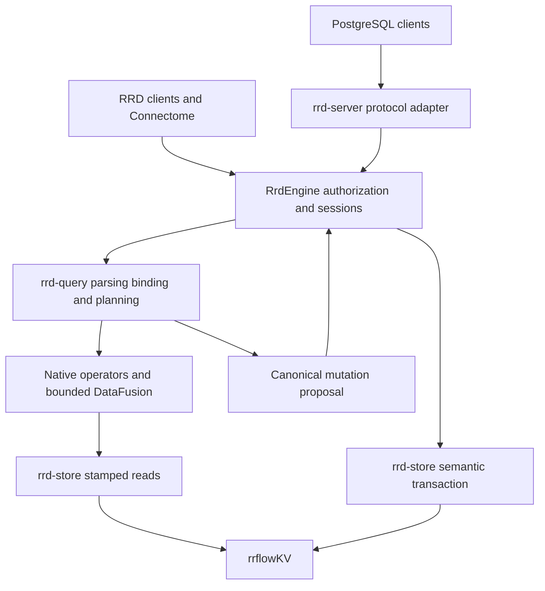

# rrflowDB PostgreSQL compatibility and independent database contract

**Status:** active target contract; implementation and qualification remain open
**Coordinate:** `rrflow://rrflow-instance/data/reference/protocol/postgresql`
**Owner:** rrflowDB PostgreSQL compatibility scope, semantic mapping, and qualification requirements

[README](../../../README.md) owns product identity and maturity. The
[system overview](../../architecture/system-overview.md) owns the one-engine
architecture. [Gate H, H-08](../../roadmap/rrflow-1.0/gate-h.md#h-08-postgresql-compatibility-packages)
alone owns package order and acceptance; [Gate J](../../roadmap/rrflow-1.0/gate-j.md)
owns release. [POAM-011](../../poam/rrflow-1.0-alpha/poam-011.md) records the
implementation gap. This contract defines the first supported compatibility
profile; it is not a claim that the current binary serves PostgreSQL clients.

## Product decision

Build and maintain rrflowDB as RRFlow's own pure Rust database engine,
inspired by PostgreSQL and dedicated to AI knowledge, memory, reasoning,
retrieval, and evidence. rrflowKV remains the native durable storage engine.
RRFlow controls first-party source, schemas, persisted formats, builds,
operation, backup, and release decisions. No Turso, libSQL, SQLite, PostgreSQL
server, vendor account, hosted control plane, or license service is required
to install or run the default database.

The first release target is **rrflowDB PostgreSQL core profile 1**: the
PostgreSQL 18 behavior reference for the explicitly listed SQL features and
clients below, over frontend/backend protocol 3.0. This is a technical profile
identifier, not a product-version change. RRFlow remains `1.0.0`, pre-alpha.
Protocol 3.2 clients must negotiate down correctly or receive an explicit
unsupported-version response; do not advertise 3.2 behavior without its corpus.
PostgreSQL itself distinguishes protocol versions from server releases
([protocol specification](https://www.postgresql.org/docs/18/protocol.html)).

The profile is a useful application/AI database target, not universal PostgreSQL
drop-in, extension-binary, disk-format, or replication compatibility. Deferred
features remain explicit expansion work. No runtime is marked compatible until
all required profile cases pass against a real installed binary.

## Existing foundation and concrete gaps

| Inspected boundary | Existing behavior | Work still required |
|---|---|---|
| `rrd-lsm`, `rrd-store` | Native WAL, MVCC, hybrid immutable segments, transaction port, recovery and storage evidence | Finish existing C-04/C-07 qualification; prove SQL workloads over these paths |
| `rrd-core/src/runtime.rs`, `schema.rs` | Canonical temporal records/relations, property values, schema catalogue | SQL type identity, typmods, nullability, defaults, constraints and relational schema evolution |
| `rrd-query/src/syntax.rs`, `plan.rs` | Narrow rrflowQL grammar and stamped plans | PostgreSQL parsing, SQL binding/coercion/NULL semantics, relational DDL/DML and supported SELECT lowering |
| `rrd-query/src/fusion.rs`, `arrow.rs` | DataFusion execution with materialized rows | Existing Gate F streaming work plus SQL semantic parity; parser dialect selection alone is insufficient |
| `rrd-store/src/transaction.rs` | Snapshot-isolated byte transaction and write-conflict detection | PostgreSQL statement snapshots, read/write overlay, savepoints, abort state, locks and constraint concurrency |
| `rrd-engine/src/engine/transaction.rs` | Authorized leases, prepared mutations, idempotency and receipts | SQL session/transaction lifecycle mapped into that authority |
| `rrd-server/src/http/` | RRD HTTP and WebSocket | Bounded PostgreSQL listener, authentication, wire state machine and codecs |
| `rrd-operator-knowledge/src/pgvector_postgres.rs` | Outbound client to an external PostgreSQL/pgvector instance | No inbound PostgreSQL server capability is supplied by this adapter |

The inspected workspace manifests and lockfile contain no Turso/libSQL/SQLite
database dependency. This does not prove deployed projects contain no such
data; inventory their sources before any migration. Native persistence exists,
so this plan extends its semantics rather than starting another storage kernel.

## One execution and authority path

`rrd-server` handles bytes, connection-local statement/portal handles and
responses; it has no direct storage access. `rrd-core` owns canonical values
and schema meaning. `rrd-query` parses SQL into a bounded AST, binds it against
an authorized catalogue snapshot, and produces the same canonical plans and
mutation proposals used by native callers. `RrdEngine` chooses read identity,
authorizes effects, enforces budgets and commits through `rrd-store`.

All PostgreSQL-originated durable actions map to catalogue-declared engine
capabilities. Existing capability entries are reused; missing SQL capabilities
are added to the executable owner and its generated projections in the same
package. Do not create a second SQL operation registry or call physical storage
from a wire handler. Native and SQL clients must observe the same committed row,
schema, index, audit and receipt.

One connection's startup database selects one explicitly installed estate.
The authenticated user maps to one RRFlow principal and allowed schema/actions.
No wildcard database creation, cross-estate query, or cloud account requirement
is implied. Installation/configuration owns listener activation and credentials.
Ordinary SQL statements use the principal's configured authorization; they do
not require an interactive approval dialog for each query.

## Required core profile

Every row below is **required target work, not implemented compatibility**.
H-08a assigns stable case IDs to each supported statement form and edge case;
the later executable catalogue generates the support report from those cases.
The exact reference PostgreSQL patch, driver versions, binaries/images and
source revisions are locked before recording results; a moving `latest` tag
cannot be an oracle. PostgreSQL 18 is the selected reference family.

| Area | Required profile 1 behavior | Explicit limit or denial |
|---|---|---|
| Session | Startup database/user/options, truthful version/profile reporting, UTF-8, `application_name`, `search_path`, `SET`/`SHOW`/`RESET` for the declared parameter set | Unknown semantic settings fail; never accept a setting and ignore its effect |
| Wire | Simple query; Parse/Bind/Describe/Execute/Close/Flush/Sync; named/unnamed prepared statements and portals; bounded portal suspension/resume; text and binary values for supported types; cancellation and error resynchronization | No hardcoded `SELECT 1` success path; no unbounded statement or portal cache |
| Authentication | TLS on network endpoints; SCRAM-SHA-256 and channel-bound SCRAM-SHA-256-PLUS where advertised; expiry, revocation, quotas and principal isolation | No default anonymous network user, plaintext remote credentials or MD5 password mode |
| Schema/DDL | Schemas and tables; quoted/unquoted identifiers; create/drop; add/drop/rename columns; transactional catalogue changes; primary/composite keys, unique, NOT NULL, CHECK, immediate foreign keys with NO ACTION | Deferred constraints, inheritance, partitioning, generated columns and procedural triggers are outside profile 1 |
| DML | INSERT with values or supported SELECT, UPDATE, DELETE, RETURNING, and `ON CONFLICT DO NOTHING/DO UPDATE` against an explicit unique arbiter | Unsupported syntax fails before effects; no whole-statement partial commit |
| SELECT | Projection/aliases, WHERE, inner/left joins, GROUP BY/HAVING, count/sum/min/max/avg, DISTINCT, ORDER BY, LIMIT/OFFSET, UNION ALL, nonrecursive CTEs, scalar expressions and bind parameters | Recursive CTEs, window functions, lateral/correlated subqueries and arbitrary PostgreSQL built-ins are deferred; accepted parser AST is allowlisted |
| Scalar types | bool; int2/int4/int8; float4/float8; numeric precision up to 38; text/varchar; bytea; uuid; date/time/timestamp/timestamptz with microsecond precision; json/jsonb; one-dimensional arrays of supported scalar types | Explicit range/typmod errors; no unsigned-to-signed wrapping, float-to-decimal approximation, JSON number loss, unknown OID cast, or silent array flattening |
| Type semantics | Three-valued NULL logic; casts and coercions; NaN/infinity policy per admitted type; date/timezone and DST fixtures; numeric rounding/overflow; text/binary parity; JSON vs JSONB distinction | UTF-8 and C/POSIX collation first; other collations, range/multirange, domain, enum, composite, large-object and interval types deferred |
| Transactions | Autocommit, BEGIN/COMMIT/ROLLBACK, READ COMMITTED default, REPEATABLE READ, read-your-writes, statement atomicity, savepoints, failed-transaction state and bounded lock waits | SERIALIZABLE and two-phase commit explicitly rejected until separately proved; never relabel snapshot isolation as serializable |
| Catalogue discovery | Authorized projections of `pg_namespace`, `pg_class`, `pg_attribute`, `pg_type`, `pg_index`, `pg_constraint`, `pg_database`, `pg_roles`, and information_schema tables/columns/constraints; required type/identity/version functions | Only supported columns/functions are promised; no fabricated extensions, roles, relations, or permissions to satisfy a tool |
| Bulk transfer | Client-streamed COPY FROM STDIN / TO STDOUT, text and CSV, bounded buffers, cancellation and full-statement rollback | Binary COPY, server filesystem paths and COPY PROGRAM deferred or denied; no arbitrary shell/filesystem effect |
| Errors | Correct SQLSTATE class/code, constraint/table/column detail when authorized, statement position, transaction status and redaction | SQLSTATE `0A000` for deliberately unsupported features; syntax, authorization, data and conflict errors retain their real classifications |
| AI vector surface | Bundled `vector(n)` SQL type, `<->`, `<=>`, `<#>` distance forms and admitted vector index DDL mapped to RRFlow native collections and indexes | A narrowly declared pgvector-style surface, not the PostgreSQL extension ABI or all pgvector types/functions; no downloaded extension |
| Operations | Install, serve, readiness, inspect, cancellation, verify, backup, restore and uninstall through the existing primary executable | `VACUUM`, REINDEX, SQL administration and dump tooling only succeed if explicitly implemented and tested; no success-shaped no-ops |

The parameter and function allowlist must include the bootstrap queries used
by the pinned clients, including `server_version`, `server_version_num`,
`client_encoding`, `DateStyle`, `TimeZone`, `standard_conforming_strings`,
`transaction_isolation`, `transaction_read_only`, `statement_timeout`,
`lock_timeout`, `version()`, current database/user/schema, and the catalogue
type-formatting functions their actual discovery traces require. For driver
version parsing, the target reports `server_version` as
`18.0 (rrflowDB PostgreSQL core profile 1)` and `server_version_num` as `180000`:
these designate the selected compatibility reference, not the RRFlow product
version or all PostgreSQL 18 features. `version()` identifies RRFlow and its
actual build/profile, and the generated support report is authoritative for
feature coverage. Qualification must test driver branches selected by these
values; a higher advertised number cannot conceal missing behaviour. A tool
relying on additional behaviour is unsupported until it joins the matrix and
passes.

PostgreSQL [types](https://www.postgresql.org/docs/18/datatype.html),
[catalogues](https://www.postgresql.org/docs/18/catalogs.html),
[SQLSTATEs](https://www.postgresql.org/docs/18/errcodes-appendix.html), and
[COPY](https://www.postgresql.org/docs/18/sql-copy.html) supply reference
behaviour. The bounded choices in this table are RRFlow design decisions.
The [pgvector project](https://github.com/pgvector/pgvector) is the vector SQL
comparison input; RRFlow retains its own storage and native vector execution.

## Required semantic work before a compatible listener

**Relational identity and types.** Map a SQL table to one canonical logical
table ID in the estate catalogue, a row to one stable internal record identity,
and SQL columns to typed canonical values. Tables without a primary key still
receive internal row identities. A primary key is a constrained logical key,
not the physical address or authorization scope. SQL schemas are catalogue
namespaces, not new estates. Persist generated OIDs and schema revisions under
the existing transaction authority; built-in type OIDs use their reference
identities. No transport-local catalogue can become durable truth.

Extend the canonical value/schema representation where it lacks SQL identity,
nullability, binary values, precision, temporal types or constraint semantics.
`Decimal(String)` and generic maps/lists do not by themselves implement numeric,
JSONB or typed arrays. Preserve exact scalar identity across WAL, indexes,
Arrow, result codecs and restart. Converge current serializers/consumers in one
bounded package with characterization tests; do not hide new values in opaque
SQL-only JSON or create a parallel relational store. User tables and protected
RRFlow AI system data share the engine; user SQL cannot write lifecycle records
by addressing internal tables.

**Queries and temporal reads.** Bind an implicit SQL read to an engine-issued
stamp at statement start for READ COMMITTED, or the transaction snapshot for
REPEATABLE READ. Capture wall-clock-dependent SQL values explicitly for replay.
rrflowQL retains its explicit valid-time/known-state syntax; SQL does not gain
an adapter-owned ambient snapshot. SQL and rrflowQL lower into shared typed
relational operators. DataFusion handles admitted analytical work under the
same authorization and resource limits; its parser or default coercions cannot
silently define PostgreSQL behaviour. No DataFusion MemTable becomes persistence.

**Transactions.** Extend engine-owned session state with staged typed writes,
statement checkpoints and savepoint stacks. READ COMMITTED needs a fresh
statement snapshot plus the transaction's own writes, correct concurrent UPDATE
predicate rechecks, unique/FK conflict handling, bounded row/constraint locks,
deadlock handling and commit ordering. REPEATABLE READ pins the transaction
snapshot and reports update conflicts correctly. Existing byte snapshot
isolation is useful groundwork, not proof of these semantics. PostgreSQL's
[isolation definitions](https://www.postgresql.org/docs/18/transaction-iso.html)
and [savepoints](https://www.postgresql.org/docs/18/sql-savepoint.html) are the
differential references. Never downgrade an isolation request silently.

One accepted SQL commit publishes the canonical row/schema mutations, relevant
graph/scalar/vector source changes, audit/outbox and receipt atomically. SQL
savepoint rollback must undo all staged families, not just row values. A failed
statement in an explicit transaction remains failed until the correct rollback;
wire ReadyForQuery reports idle/transaction/failed state accurately. Disconnect
rolls back uncommitted work. A lost COMMIT acknowledgement is an uncertain
outcome for an ordinary PostgreSQL client; server receipts help inspection but
cannot make blind client retries exactly-once.

**Protocol and authentication.** Follow the
[message-flow](https://www.postgresql.org/docs/18/protocol-flow.html) and
[SASL](https://www.postgresql.org/docs/18/sasl-authentication.html) specifications
for startup, authentication, prepared operations and synchronization. Bound
every frame before allocation and every portal result stream. Cancellation keys
are unpredictable, scoped to a live session, revoked on close, and never logged.
Policy checks also apply to parse/describe and catalogue discovery, not only
execution. Prepared plans bind schema revision and authorization identity;
schema or policy changes force revalidation, not stale-plan execution.

## AI-first behaviour and resource contract

Core AI value is the same transactionally consistent temporal knowledge,
relations, native BM25/vector retrieval, hybrid ranking, context provenance and
governed reasoning used by RRFlow. SQL exposes admitted operations through a
generated RRFlow function/type namespace; model calls and external effects
remain explicit governed capabilities. A SELECT or table trigger cannot
silently invoke a model/provider or charge an external service.

Expose read stamps, plan identity, source cursors, completeness and commit
receipts through authorized diagnostic operations and SQL-accessible projections
of those operations. Keep wire results interoperable; do not add mandatory
private protocol messages. Native APIs remain the richer control surface.

Bind connection count, frame/statement bytes, parse depth/AST nodes, prepared
statements, portals, transaction duration/write-set bytes, lock wait, scan bytes,
query memory, spill bytes, elapsed time and result bytes to engine configuration.
The first harness freezes numeric defaults and hard caps before the listener
can be enabled; each has below/at/over-limit cases. SQL results are complete or
return an error: never silently truncate a SELECT because a resource budget was
exhausted. Cursor/portal suspension is explicit protocol flow, not truncation.
Backpressure, cancel, idle transactions, disconnect and timeout release memory,
locks, snapshots and temporary spill files. Gate F owns shared operator budgets.

## Build inputs, ownership and trade-offs

| Choice | Decision and reason | Proof/revisit point |
|---|---|---|
| Database kernel | Keep RRFlow-owned Rust storage, semantics, query integration and lifecycle; no Turso/libSQL fork or PostgreSQL process | C/F/H-08 source closure and offline J qualification |
| Wire codec | Evaluate locked `pgwire` as a replaceable protocol library inside `rrd-server`; build an in-repository adapter | H-08a verifies feature matrix, licence/provenance, fuzzability and selected-version API before adding a dependency |
| SQL parser | Reuse the Rust sqlparser family already used by DataFusion where compatible with the lockfile; strict PostgreSQL dialect/AST admission | H-08b parser/property tests; unsupported constructs fail before binding/effects |
| Query compute | Keep the pinned DataFusion integration and implement the stamped provider planned in F | F/H-08 result/type/coercion differentials; do not assume a newer documented API exists in the pinned version |
| Extensions | Implement admitted capabilities in Rust over native engine operations; no PostgreSQL C extension loader | Vector corpus first; later extensions require their own scope/evidence |
| Distribution | Owner-buildable native signed artifacts, offline runtime, complete dependency/source and licence manifests | J-03/J-05; loss of an upstream hosting account must not prevent rebuilding from retained source inputs |

[pgwire](https://github.com/sunng87/pgwire) supplies protocol machinery, not SQL
semantics. [sqlparser](https://github.com/apache/datafusion-sqlparser-rs) is a
parser input, not a database. DataFusion's
[custom provider boundary](https://datafusion.apache.org/library-user-guide/custom-table-providers.html)
separates table description, execution plan and stream; that informs the
existing Gate F integration. These are research inputs, not authority to add
an unpinned library or copy an upstream crate tree.

"Pure Rust database" applies to the database kernel and query/transaction
implementation. The release dependency audit separately enumerates native
cryptography, compression, platform or optional-adapter components; it must not
advertise a wholly Rust artifact without proving that stronger claim. The
workspace currently declares `MIT OR Apache-2.0`; J-05 must include the actual
first-party licence texts, required third-party notices and SBOM. Ownership of
RRFlow changes does not erase upstream rights or notices. No licence change is
made by this plan.

## Exit from Turso and data portability

The repository does not identify a specific deployed Turso database or dataset.
Build the import path against synthetic fixtures first; no live data is moved
by this plan. Turso's [compatibility record](https://github.com/tursodatabase/turso/blob/main/COMPAT.md)
describes SQLite-oriented semantics, while its
[current project](https://github.com/tursodatabase/turso) also identifies an
experimental PostgreSQL frontend. RRFlow must identify whether a source is
hosted libSQL, Turso Database, SQLite, or that frontend before selecting an
export method. This plan makes no claim about a vendor acquisition.

1. Inventory schemas, indexes, constraints, type usage, auth, vectors, row counts
   and application query traces through an explicitly authorized read binding.
   Record source product/version and a consistent snapshot identifier.
2. Acquire an independently retained export using the source's supported
   snapshot/backup or transactionally consistent export. Source tooling runs
   outside rrflowDB's installed runtime; pin the exporter and its provenance.
3. Preview schema/type conversions: SQLite affinity, integer booleans, datetime
   strings, rowid/autoincrement, NULL/unique rules, collations, JSON and vectors.
   Lossy/unsupported conversions fail with a report; no silent coercion.
4. Import into an absent staging estate through typed authorized engine
   operations. Use bounded, receipt-bound chunks with a resumable import ledger
   and stable source keys. Do not run arbitrary exported SQL or bypass validation.
5. Compare per-table counts, normalized row digests, constraints, vector
   dimensions and representative query results, then backup/restore/reopen.
   Prove every converted field, including NULL and binary values.
6. For the first supported cutover, pause source writes, take the final snapshot,
   validate, then explicitly switch the application endpoint. No dual-write or
   CDC promise is made. Retain the source and export for the agreed rollback
   window; a post-cutover rollback must reconcile new target writes first.

This is one-way external data import through the accepted inventory/mutation
flow, not a historical RRFlow format reader or alternate persistence lane.
RRFlow also provides a versioned logical export of its supported data plus
native backup/restore. A user must be able to recover and move their data
without a vendor account. SQL dump/restore tooling is supported only after its
specific emitted grammar and catalogue queries pass; native backup is the
first release recovery authority.

## Qualification and first official release

Initial fixture selections, researched on 2026-10-19:

| Reference/client | Selected version | Primary provenance |
|---|---|---|
| PostgreSQL reference and psql/libpq | 18.6 | [Official source archive](https://www.postgresql.org/ftp/source/v18.6/) |
| Rust tokio-postgres | 0.7.18 | Existing Cargo.lock; [upstream changelog](https://github.com/rust-postgres/rust-postgres/blob/master/tokio-postgres/CHANGELOG.md) |
| Python Psycopg | 3.3.6 | [Release notes](https://www.psycopg.org/psycopg3/docs/news.html) |
| Go pgx | 5.11.0 | [Upstream release](https://github.com/jackc/pgx/releases/tag/v5.11.0) |
| Node pg | 8.23.0 | [Upstream changelog](https://github.com/brianc/node-postgres/blob/master/CHANGELOG.md) |
| Java pgjdbc | 42.7.14 | [Official downloads](https://jdbc.postgresql.org/download/) |
| .NET Npgsql | 10.0.3 | [Upstream release](https://github.com/npgsql/npgsql/releases/tag/v10.0.3) |

These are fixture selections, not installed, tested or shipped dependencies.
H-08a must resolve source/artifact digests, supported host toolchains and exact
options into test lockfiles before execution; a version update is reviewed with
its changed cases. Exercise simple/prepared/binary modes, transaction/rollback,
cancellation and connection pooling where the client supports them. `psql`
coverage includes connecting, running admitted SQL and client COPY; it does not
imply every backslash command. Catalogue/metadata API coverage names exact
operations in the support report rather than claiming complete tooling support.
Test Linux, Windows and macOS installed servers; do not infer all-platform compatibility
from one Linux test. ORM support is separate: do not advertise Prisma, Django,
SQLAlchemy, Hibernate, or migration-tool compatibility based only on a driver.

The H-08 corpus compares admitted cases with a locked PostgreSQL 18 reference:
typed values/metadata, deterministic ordering where specified, SQLSTATE,
affected rows, commit/rollback and concurrency outcomes. Unordered SQL results
are compared as multisets. Clock, locale, floating-point and nondeterministic
functions have explicit comparison rules, never blanket exclusions.
Selected PostgreSQL [regression cases](https://www.postgresql.org/docs/18/regress.html)
may be reference inputs with preserved provenance; passing a selection is not
the full PostgreSQL regression suite.

Adversarial cases include fragmented/oversized frames, invalid encodings and
OIDs, parse-depth attacks, wrong credentials, catalogue leakage, stale plans,
cross-principal cancellation, malformed COPY, savepoint nesting, aborted
transactions, deadlocks, constraint races, lost acknowledgements, disk full,
process kill, reopen, schema changes during queries and all resource limits.
All supported operations must agree with native APIs over the same estate.
Generated support reports list every pass/fail/skip with reference identities;
a required skip blocks qualification.

Measure point reads/writes, batched ingest, joins/aggregation, filtered vector
and mixed AI/SQL workloads at multiple data sizes, including larger than memory,
with the fixed-hardware/quality rules of J-04. Record latency distributions,
throughput, errors, RSS, disk/WAL amplification and restart time; set acceptance
budgets before the run. No speculative performance claim or calendar release
date substitutes for these measurements.

An official RRFlow release requires the required profile corpus, native engine
gates, the Turso-exit synthetic rehearsal, independent backup/restore, clean
offline native installation, reproducible provenance/licences, vulnerability
and dependency review, signatures and the owner's exact promotion decision.
Public development candidates can precede qualification when labelled honestly.
shippin.cloud devspace isolation/code execution and DevPulse account/sync are
separate integrations; neither supplies missing database correctness or becomes
a prerequisite for local operation.
