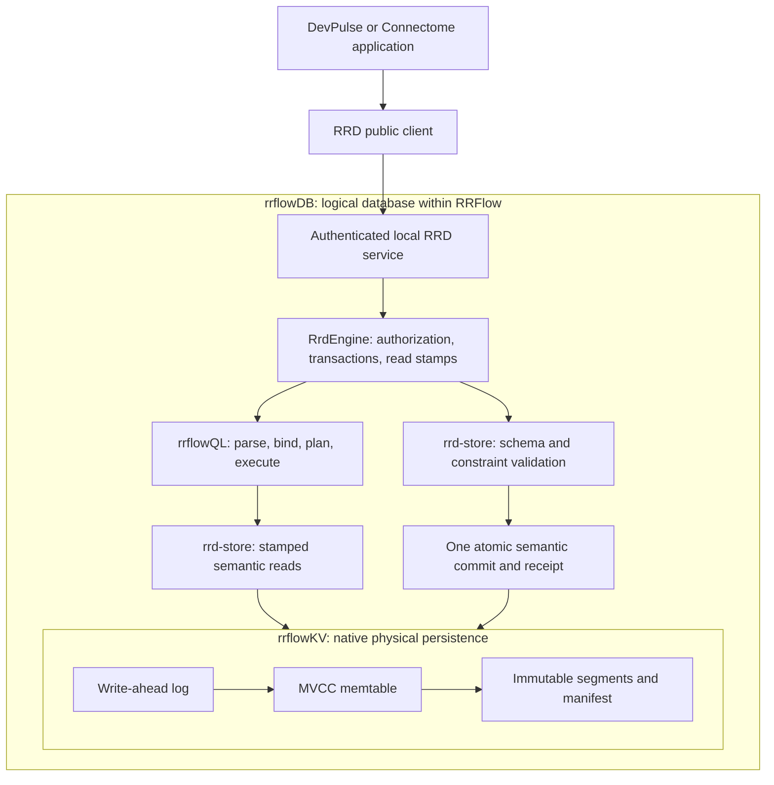

# Build against local rrflowDB

**Status:** active native database integration guide; pre-alpha, not PostgreSQL qualification
**Coordinate:** `rrflow://rrflow-instance/data/reference/sdk/rrflowdb-local`
**Owner:** runnable installed native database example and its integration instructions

rrflowDB is usable through the native Rust engine and authenticated RRD client.
This guide builds a real persistent local database, creates typed relational
records and graph relationships in one transaction, queries them with rrflowQL,
and reads them after restart. It uses no Turso, libSQL, SQLite, PostgreSQL server,
cloud account, or external model. The [PostgreSQL profile](../protocol/postgresql.md)
remains a separate unimplemented compatibility requirement.

## How the components relate



rrflowQL is a language/execution component; rrflowDB is the logical database;
rrflowKV stores its durable bytes. They are not three databases to synchronize.
`RrdEngine` owns authorization and commits. DataFusion is an analytical executor
under that authority. The [engine data-flow owner](../../architecture/engine-data-flow.md)
defines the complete boundary and its remaining qualification gaps.

## Build and install

Use the repository's pinned Rust toolchain. From the repository root in PowerShell 7:

```powershell
cargo build --locked -p rrflow-cli --bin rrflow -p rrd-client --example rrflowdb
$project = Join-Path $env:TEMP ('rrflowdb-' + [guid]::NewGuid().ToString('N'))
New-Item -ItemType Directory -Path $project | Out-Null
$project
$planFile = "$project-install-plan.json"
$identity = & .\target\debug\rrflow.exe install identity | ConvertFrom-Json
if ($LASTEXITCODE -ne 0) { throw 'Installation identity generation failed' }
$plan = & .\target\debug\rrflow.exe install plan --project $project --identity $identity.installation_identity --mode fresh
if ($LASTEXITCODE -ne 0) { throw 'Installation planning failed' }
$plan | Set-Content -LiteralPath $planFile -Encoding utf8NoBOM
$preview = Get-Content -Raw $planFile | ConvertFrom-Json
$preview.installation
# Review the exact managed paths, configuration and permissions above.
& .\target\debug\rrflow.exe install apply --project $project --mode fresh --plan $planFile --expect $preview.installation.plan_sha256
& .\target\debug\rrflow.exe serve --project $project --bind 127.0.0.1:9477
```

`serve` stays in the foreground. In a second terminal, set `$project` to that
same printed project path, then run:

```powershell
.\target\debug\rrflow.exe ready --project $project --address 127.0.0.1:9477
.\target\debug\examples\rrflowdb.exe $project 127.0.0.1:9477 init
.\target\debug\examples\rrflowdb.exe $project 127.0.0.1:9477 read
.\target\debug\examples\rrflowdb.exe $project 127.0.0.1:9477 update
.\target\debug\examples\rrflowdb.exe $project 127.0.0.1:9477 abort
.\target\debug\examples\rrflowdb.exe $project 127.0.0.1:9477 schema
```

On Linux/macOS use `target/debug/rrflow` and `target/debug/examples/rrflowdb`;
the commands and JSON contracts are identical. A custom `CARGO_TARGET_DIR`
changes the binary location. These are source-built development artifacts, not
a signed official release. Installed estates bind the executable digest:
retain the binary used to install them; replacing it is not an automatic upgrade.

Stop the service, run `rrflow verify --project <path> --level quick`, restart
`serve`, and run the example's `read` again. The task remains `done`. The
database lives under the engine-managed `.rrflow/rrd/` root selected by
`.rrflow/config.toml`. Do not open that root with a second engine process.
The example reads the installed locator and API credential locally without
printing the credential, then performs all data work through the public client.

## Implemented example model

```mermaid
erDiagram
    DEVPULSE_PROJECT ||--o{ DEVPULSE_OWNS : from
    DEVPULSE_TASK ||--o| DEVPULSE_OWNS : to
    DEVPULSE_PROJECT {
        string id PK
        string slug UK
        string name
    }
    DEVPULSE_TASK {
        string id PK
        string title
        string status
    }
    DEVPULSE_OWNS {
        string id PK
        string from_id FK
        string to_id FK
    }
```

The native record identity is `(kind, id)`. Each owns relationship references
existing project/task identities; its endpoint kinds, unique pair, and maximum
one incoming relationship per task are schema constraints. Unlinked tasks are
permitted. `slug` is required and unique; `name`, `title`, and `status` are
required strings. Values also have valid-time intervals and commit coordinates.
The diagram describes this application's schema, not additional platform
project/estate/account authorities.

The parameterized native join is:

```text
FROM record:devpulse_project
JOIN relation:devpulse_owns ON id = from_id
AT VALID $at KNOWN HEAD
WHERE left.slug = $project
PROJECT left.name, right.to_id
```

`$at` is an unsigned millisecond timestamp; `$project` is the string `local-ai`.
Parameters remain typed values. This is rrflowQL syntax, not PostgreSQL SQL.

## Application integration

The runnable source is [rrflowdb.rs](../../../crates/transport/rrd-client/examples/rrflowdb.rs);
its [application operations](../../../crates/transport/rrd-client/examples/support/rrflowdb.rs)
use `RrdClient` and public contract types. Adapt these operations inside
DevPulse's backend, using its installed process adapter and secure credential
handling. The example is integration source, not a second supported database
binary or a replacement for `rrflow` installation/lifecycle.

`read_data_schema` resolves `data-schema-read` from the operation catalogue.
It requires an unrestricted instance-level `diagnostics-read` grant, returns
one authenticated native schema/read stamp and bounded I/O evidence, and does
not read all application records. An application planning DDL begins a data
transaction, reads the schema, and requires the returned cursor to match the
lease before extending the catalogue. A stale revision/transaction is rejected;
it must be replanned, never silently merged. Ordinary data access uses separately
authorized queries and transactions.

`init` adds tables to the current catalogue and atomically creates the sample
records/relationship. It refuses a second initialization. `update` commits a
new temporal task version. `abort` opens and cancels an empty transaction.
Commit requests bind a payload digest, idempotency key and lease-bounded
deadline. An unknown transport or storage outcome must be reconciled with its
original identity; do not blindly retry a write with a new key.

The [real-server regression](../../../crates/transport/rrd-client/tests/rrflowdb_local.rs)
tests schema preservation, parameterized joins, typed/unique rejection with
no partial write, explicit abort, receipt replay, historical reads, scope and
budget denial, closed-session denial, and disk reopen. Run it with:

```text
cargo test --locked -p rrd-client --test rrflowdb_local
```

DevPulse's optional [shippin.cloud account and synchronization boundary](../client/devpulse-cloud.md)
is explicit. Running this local example does not create an account, enable
synchronization, publish a project, or upload data.
