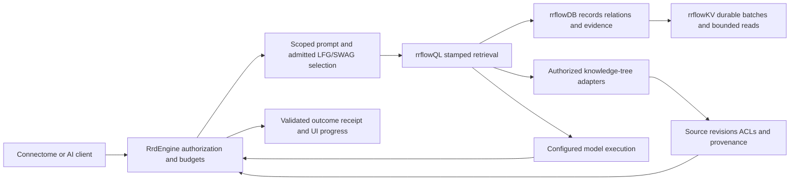

# C-07 — installed durability and bounded growth

**Status:** active canonical implementation plan; C-07a/b have bounded contract and I/O-model evidence, C-07c–h remain unimplemented or unqualified
**Coordinate:** `rrflow://rrflow-instance/data/roadmap/rrflow-1.0/gate-c-07`
**Owner:** [Gate C](gate-c.md), under the [RRFlow 1.0 release roadmap](../rrflow-1.0.md)

This chapter decomposes C-07; it does not create another roadmap or change
alpha status. OBJ-02 is the owning outcome; OBJ-03/07/10 consume its evidence.
The [dependency spine](executable-dependency-spine.md) still owns execution
order. [POAM-035](../../poam/rrflow-1.0-alpha/poam-035.md) tracks this
qualification gap. [The planning baseline](../../evidence/change-journals/gate-c/c-07-planning-baseline.md)
records code inspection and executed component tests at `b6052fee`.

## Result required

One installed native engine must preserve every acknowledged authoritative
commit, publish atomic batches, reject uncertain or corrupt state safely, and
keep admission, maintenance, recovery and retained buffers within explicit
limits as the estate grows. The same semantic behavior must hold on a small
local allocation and a larger single-node service allocation. This is a
single-node qualification: distributed consensus, replication, cloud placement
and fleet management retain their existing gates.

Keep the accepted segment-v6 format, WAL, manifest and native store. rrflowDB
owns semantic records/relations/evidence; rrflowKV supplies physical durability;
rrflowQL consumes authorized stamped reads. C-07 does not replace these with
an upstream database, add a second coordinator, or turn maintenance into an
independent runtime. Connectome will consume public engine capabilities;
default engine operation must not depend on the UI or a vendor account.

### Existing foundation and remaining proof

| Current behavior | What C-07 must add or qualify |
|---|---|
| Authoritative WAL append requests synchronization; complete corruption is distinguished from an incomplete tail. | Actual short-write/sync/publication failure coverage, exact uncertain-outcome handling, native process-death and acknowledged-history reconciliation. |
| Maintenance flushes synchronously on the next write when thresholds would be exceeded; one oversized atomic batch is retained and counted. | Separate soft targets from hard admission limits; bound all live owners and outstanding work, including one batch and retained generations. |
| Compaction bounds input segment count and targets output size at key boundaries. Automatic compaction retains untracked snapshot history. | Bound bytes/work and debt as well as counts; account for hot keys with long histories, stalled reclamation and safe retention. Never erase required versions merely to meet a target. |
| Transaction/read-view leases and manifest reachability protect snapshots; projected reads have limits and cancellation. | Concurrent reader/writer/compaction/GC histories and buffers retained beyond stream lifetime, across native OSes and actual memory measurement. |
| Component failure matrices inject typed errors and reopen. D-01 exercises real installed binaries. | Join these proofs: labeled StorageFull is not native disk exhaustion, dropping an object is not a killed process, and a killed process is not loss of volatile OS/device caches. |
| Component RSS fixtures are Linux-only; existing physical diagnostics are useful but partial. | Native process memory, pinned/mapped/private allocations, queue/debt and recovery-cost evidence with bounded observability. |

The known whole-scope commit-validation cost in
[POAM-034](../../poam/rrflow-1.0-alpha/poam-034.md) remains E-01/E-02 work.
C-04/POAM-028 and the rejected/uncertain transaction distinction in POAM-033
remain separately tracked. Do not disable constraints, shrink the corpus or
claim database-wide scale to conceal those limits.

## Decisions and invariants

1. **Acknowledgement has a precise boundary.** Success for an authoritative
   local commit requires its admitted native durability barrier. Preserve a
   separate buffered mode where supported; never label it durable or use it
   for a durability benchmark. A remote response timeout cannot establish
   rejection. A lost response may correspond to a committed operation; resolve
   its existing request/commit identity and receipt before retrying effects.
2. **Recovery never guesses.** Validate identity, format, checksums, sequence
   continuity and manifest reachability. An intact referenced WAL can replay;
   a torn tail needs the existing explicit repair boundary; missing/corrupt
   authoritative bytes cannot silently select an older successful-looking state.
   Ordinary installed open and verify preserve damaged bytes. Full repair and
   salvage remain D-11, with C-07 supplying corruption/recovery prerequisites.
3. **Publication is ordered.** WAL synchronization, immutable output,
   successor WAL, manifest and current-pointer publication, and reclamation
   have separate fault boundaries. Record uncertain sync/rename outcomes and
   fence further writes when needed. Never acknowledge a failed barrier or
   free the old reachable generation before publication is durable.
4. **Bounds cover owners, not just caches.** Charge mutable versions, encoded
   batches, copy-on-write snapshots, queues, compaction inputs/outputs, decoded
   pages, cached pages, retained batches and pinned files. Count shared owners
   consistently; distinguish conservative reservation from actual allocation.
   Report RSS and file residency separately from logical reservation totals.
5. **Pressure changes admission, not correctness.** Finite deadlines, bounded
   queue bytes/counts, cancellation and explicit pressure outcomes replace
   indefinite waiting. Admission failure occurs before a durable effect;
   timeout after effects remains uncertain until reconciled. A blocked slow
   reader cannot permit unlimited pinning or unsafe reclamation.
6. **No automatic learning changes storage policy.** LFG/SWAG may later propose
   configured actions; deterministic engine authorization, limits and validation
   remain authoritative. No prompt, UI setting or connector bypasses them.

### Options and consequences

| Choice | Decision for C-07 | Tradeoff and revisit condition |
|---|---|---|
| Synchronous versus background maintenance | Start from the current synchronous implementation and measure lock/queue time. | Simple ownership can stall requests. Add bounded engine-owned background work only if measured latency requires it and crash/cancellation/single-writer tests pass; no detached unbounded worker. |
| Per-write sync versus group commit | Preserve authoritative per-write semantics as the oracle. | Group commit is a later measured optimization within the same commit boundary: finite group bytes/wait, no early ACK, identical order/receipt/failure results. It is not a prerequisite to calling the plan complete. |
| Cache/codec/format replacement | Preserve accepted C-06 policies and format. | Tune only after same-corpus attribution shows a bottleneck; retain exact oracle, corruption and lifetime evidence. TurboQuant is not a WAL codec. |
| Long-lived history | Preserve accepted semantics and explicitly track pins, checkpoints and retention. | Growth may be unavoidable while history is retained. Enforce admission/retention policy and show the blocking owner; never promise constant disk usage for indefinitely retained history. |
| Large-scale distributed storage | Defer to the distributed-cluster owner. | First establish a reproducible single-node envelope. More processes or remote storage do not by themselves provide replication, HA or isolation. |

## Ordered implementation packages

Execute a through h. Each row is a bounded review package with its own PR,
journal, smallest failing oracle and exact-candidate CI. Before implementation,
resolve current paths/symbols through the generated inventory and bind them in
the PR. If a row exposes a materially larger repair, split it at the owning
boundary before expanding edits; retain its exit conditions. None is accepted
by this planning document.

| Package | Deliverable and canonical boundary | First falsifying oracle and exit |
|---|---|---|
| **C-07a: measurement and policy contract** | At the existing evaluation/diagnostic boundaries, implement the storage subset of J-04a's versioned workload/result model and map effective installed storage settings to their owning types. Declare durability class, operation identity, limits, profile, required cases and failure provenance. Preserve the existing paired-provider evaluation behavior. | Reject unknown fields, zero/overflow limits, inconsistent budget sums, missing native identity, missing required cases and unsupported capabilities. Golden output and independent acknowledgement-ledger fixtures must distinguish success/rejection/uncertainty. No new runtime policy is accepted by a schema alone. |
| **C-07b: I/O and publication failure oracle** | Extend the native WAL/filesystem/manifest boundaries with a bounded test I/O fault facility and an independent stable-versus-volatile byte model. Cover append, sync, publication and reclamation; repair demonstrated error-handling defects at those owners. | Enumerate short/zero writes, interruption, failed data/directory sync and rename before/after effect. Sweep every eligible operation occurrence for a bounded history, including failure during recovery. Model loses unsynchronized bytes; assertions cannot read the engine's answer as their expected result. |
| **C-07c: installed crash and acknowledgement history** | Extend the existing real-primary-executable harness and engine transaction receipts. Add test-only, authenticated/owned synchronization barriers where deterministic process termination is required; production builds must have no remotely activatable fault switch. | External client ledger records sent, acknowledged, rejected and unresolved operations; kill/restart at WAL, visibility, manifest and response boundaries. Every acknowledged operation survives exactly once; unresolved operations resolve consistently; rejected operations have no domain effect. Exercise fresh/existing estates and repeat reopen. |
| **C-07d: hard resource admission and maintenance progress** | Bind finite byte/count/time/debt limits through engine-owned installed configuration; extend current maintenance policies/counters without another scheduler authority. Expose soft threshold, hard cap and effective restart requirement distinctly. | A batch above a soft threshold may remain atomic only within the hard reservation; exceeding the hard cap writes nothing. Sustained writes, a hot key, oversized values and blocked maintenance cannot grow queues or mutable state without bound. Overload is explicit, cancellation releases reservations, and debt drains after load falls. |
| **C-07e: snapshot, buffer and reclamation lifetime** | Extend the existing transaction pins, projected read leases, immutable generations, compaction and GC. Account for buffers retained after stream cancellation, clone/drop and database close. | Independent reads stay exact while writes, compaction, checkpoints and GC interleave. Retained raw/decoded buffers remain valid until the last owner drops; afterward pins and unreachable storage become reclaimable within declared bounds. Test mapped and bounded-read modes, raw/LZ4 pages and reader admission limits. |
| **C-07f: native exhaustion and damage qualification** | Use owned bounded filesystems on disposable native runners; extend installed verify/open/backup/recovery tests with genuine capacity errors and targeted corruption. | The filesystem actually reports capacity/quota failure at WAL, segment and publication phases; no fake StorageFull result substitutes. After capacity is restored, capacity-only faults must recover every acknowledged write and admit valid work. Deliberately missing/corrupt authoritative bytes must instead deny access with intact evidence. Restored/backup readback is exact; no implicit repair. |
| **C-07g: installed capacity and sustained operation** | Extend the installed harness with storage workload manifests/results from a, reusing J-04's measurement owner and profiles. Measure native memory, queue/lock time, I/O, debt, restart and backup under constrained allocations. | Run the workload and repetition matrix below; reconcile every attempt. Safety and hard-cap violations fail regardless of mean throughput. Record the largest tested sustainable envelope and every failed operating point. No graph/ANN/provider or UI completion is inferred. |
| **C-07h: acceptance and handoff** | Reconcile required cases, exact revisions/artifacts, native profiles, resource traces and retained failures in Gate C evidence; update the existing objective/ledger only when named exits pass. | Zero missing required cases, oracle mismatches, lost acknowledged writes or exposed partial batches. All required candidate CI plus native/soak evidence must pass. Keep C-04, E/F/G/H/I/J and parent alpha outcomes open where their own proof is absent. |

C-07a's [measurement implementation record](../../evidence/change-journals/gate-c/c-07a-storage-measurement-contract.md)
and [executable tool instructions](../../../eval/README.md) bind closed
manifest/result schemas, six effective-policy projections, independent
acknowledgement reconciliation and synthetic golden/negative fixtures. Its
initial oracle is admission and receipt validation, followed by the existing
maintenance/failure fixtures. Candidate CI and PR merge still bind acceptance
to the exact implementation; these fixtures are not native storage receipts.
The early J-04a measurement subset does not claim J-04a complete. C-07 uses
the existing installed test harness; the complete multi-capability J-04b
driver still follows the spine. This avoids a circular C-07/J-04 dependency
and a second benchmark authority.

C-07b's [I/O fault implementation record](../../evidence/change-journals/gate-c/c-07b-io-fault-oracle.md)
binds a unit-test-only native-call fault facility, separate stable bytes and
directory entries, independent requested/acknowledged values, compound recovery,
and repairs at WAL/publication/reclamation owners. The fixed history sweeps
every intercepted call and adds partial-header/payload, retry and reopen cases.
The [candidate CI lanes](../../operations/ci.md#diagnostic-performance-and-fault-lanes)
run this bounded oracle on all three native hosts. Exact-candidate CI and merge
remain the package acceptance boundary; the I/O model does not qualify native
process death, capacity exhaustion, device caches or installed scale. C-07c is
the next implementation package after that acceptance, while C-07 stays open.

C-07c's [first installed-history record](../../evidence/change-journals/gate-c/c-07c-client-history.md)
extends both fresh/existing primary-binary fixtures with a client-observed lost
commit response, stale rejection/explicit abort, quota reuse and three forced
reopens. Independent requested values, stable exact-retry receipts and runtime
cursor ranges detect partial or duplicate application. The native CI collector
requires both complete build-bound ledgers. This bounded transport history does
not complete c: internal WAL/visibility/publication pauses, compound recovery
and the dedicated 100-cycle profile corpus remain required below. Candidate CI
and the linked PR bind acceptance; C-07 and POAM-035 remain open.
The [relay portability correction](../../evidence/change-journals/gate-c/c-07c-relay-portability.md)
retains the first candidate's macOS failure and its deterministic helper
regression; passed isolated receipts cannot override a failing native lane.

The next [native boundary record](../../evidence/change-journals/gate-c/c-07c-native-crash-boundaries.md)
adds a unit-test-only owned-process rendezvous at physical write, sync,
visibility, publication and reclamation boundaries. Its 40 cases include 80
additional kills during recovery; WAL-only and published-segment fixtures each
perform 100 acknowledged kill/reopen cycles with exact independent values and
sequence checks. This is a storage-component prerequisite, not the installed
instrumented-primary corpus or a capacity profile. The next c package must
join the internal boundary evidence to installed authorization, semantic
transactions and stable outcomes through the existing primary-binary harness,
then run the declared profile corpus. No C-07c exit is waived by a component
test; c remains open until that composition and its exact native CI pass.

The [installed domain-crash record](../../evidence/change-journals/gate-c/c-07c-installed-domain-crashes.md)
joins five internal domain boundaries to authenticated fresh/existing primary
fixtures: pre-WAL, complete append, sync, visibility and persisted receipt
before response. Each also kills recovery before WAL application. The explicit
nondefault diagnostic build reuses the owned rendezvous; ordinary binaries
exclude it. Independent rows, cursors and stable receipts reconcile 21 attempts
per estate, with negative schedule/operation controls. Native candidate CI is
required for this package. Installed publication/reclamation composition and
100-cycle operating profiles still remain; neither this bounded history nor
the component corpus closes C-07c, d-g or POAM-035.

The [ordinary 100-cycle corpus](../../evidence/change-journals/gate-c/c-07c-installed-reopen-corpus.md)
adds fixed fresh/existing installed ACK/kill/reopen histories with every prior
transaction replayed after every restart. Its required native candidate lane
uses the ordinary optimized primary and retains complete build/configuration
and process-chain receipts. This is correctness qualification under default
settings, not an admitted constrained capacity profile. Its linked record and
candidate CI own actual results. Publication/reclamation, resource and
capacity requirements remain open; this corpus cannot close C-07 independently.

### Remaining implementation contracts

The [projected reader ownership repair](../../evidence/change-journals/gate-c/c-07e-read-view-release.md)
addresses reproduced prerequisite defects in empty-view admission release and
terminal stream source retention. It preserves the canonical registry/reader
and copied output lifetimes; its native ownership fixtures do not establish
installed GC, aggregate process memory limits or the complete e matrix.
C-07c installed maintenance must consume correct reader ownership rather than
building on falsely released pins. C-07 and POAM-035 remain open.

The [overlapping lifetime history](../../evidence/change-journals/gate-c/c-07e-interleaved-lifetimes.md)
composes the existing independent version model with two captured readers,
pinned transactions, checkpoint removal, compaction and actual reclamation.
Native candidate CI must qualify all physical/terminal cases. Copied output
survival and native file removal do not establish aggregate retained-output
admission, installed GC, measured RSS or the complete e matrix.

C-07b has now merged through [PR 56](https://github.com/rrflow/rrflow-development/pull/56):
candidate `88df70b39b0d73e91930a26d3017363c36c615f6`,
[CI run 39705515593](https://github.com/rrflow/rrflow-development/actions/runs/39705515593),
merge `ecfeea332e6d7a0138b2dbb6c393e0d734d50db9`. The next package is c.
The contracts below make c-h executable review units; they do not waive a
row above or create another completion ledger. Resolve exact current symbols
in each PR rather than maintaining a parallel source-tree plan here.

**c — installed acknowledgement histories.** Preserve the D-01 primary-binary
harness and C-07a independent ledger. Freeze requested operation/effect digests
before sending. Retain attempt start/end, client-observed ACK/rejection/unknown,
stable transaction/idempotency identity and reconciled receipt. Retries use the
same logical identity; effect count must stay one even if there are many
attempts. A server-produced receipt intercepted before client delivery is an
unknown client result, not an ACK. Unknown means neither absent nor rejected.
Query independent expected values and durable outcome identity after restart;
do not regenerate expected data from recovered rows. Include definite semantic
rejection, explicit abort/quota release and next valid work from POAM-033.

Use two complementary lanes: unmodified production binaries for transport
disconnect/response-loss/ACK-kill-reopen histories, and explicitly identified
test-instrumented builds for precise internal pauses. Internal pauses belong
before WAL, after append, after durability, after visibility, during manifest
publication/reclamation, and after durable receipt before response. The
qualification controller may stop only its owned child. A bounded local
one-use rendezvous needs owner/nonce/run identity and a deadline; it cannot be
activated by a public header, prompt or ordinary configuration. Compile it
out of distribution artifacts and verify that absence. Never label the
instrumented artifact's evidence as an unmodified release-binary run.

For both fresh/existing estates run each declared boundary, a compound
kill-during-reopen lane, duplicate retry and at least 100 forced reopen cycles
per admitted native profile. A naturally racing kill cannot claim it reached
a particular internal boundary. Capture hit/kill/reap/restart identities and
retain failed/unreached schedules. Ordinary recovery may deny a proven torn
tail; preserve bytes and use the existing explicit repair boundary where
admissible. Lost ACK, partial batch or inconsistent reconciliation stops c.

**d — admission and progress.** First map each allocation/live owner to one
reservation and release point. Bound encoding before constructing an oversized
batch; reject count/bytes overflow before WAL effects. Include semantic staging
and temporary copies, not only physical memtable bytes. Separate configured
hard caps from soft maintenance triggers and effective restart rules through
the existing installed configuration. Implement bounded request admission
before waiting on the transaction gate; define queue bytes/count/deadline and
cancellation outcomes. Reserve replacement and publication headroom before
flush/compaction, and identify readers/checkpoints blocking reclamation.

Test cap-minus-one/cap/cap-plus-one, integer overflow, one long hot-key history,
overlapping compaction, stalled readers and burst/drain. Limit rejection must
preserve domain state; uncertain post-effect failures retain their identity.
Charge shared buffers once for process accounting and conservatively to
request admission without calling those two totals equal. Recovery gets
finite work/time/memory budgets and must reopen the frozen corpus within them.
If bounded compaction cannot make progress with retained history, report the
blocking owner and deny growth rather than delete required versions. Resource
diagnostics and pressure tests ship with the enforcement, not after g.

**e — retained owners.** At fixed read stamps interleave writer, reader,
compaction, checkpoint removal and GC. Cover mapped raw pages and owned raw/LZ4
decode, cloned batches, stream cancellation, database close and last-owner
drop. Compare against an independent versioned map. Assert pins remain while
any buffer is live, no retired file is reclaimed early, and reservations and
unreachable files drain after the final owner disappears. Native memory
sampling supplements ownership counters; sampling alone cannot prove safety.
Run the matrix on Linux, macOS and Windows rather than citing Linux-only RSS.

**f — real capacity and damage.** Add explicit disposable-runner commands for
bounded ext4 loopback, APFS image and NTFS VHD/quota fixtures. Preflight must
bind the owned volume/device, cap its maximum size and prove all writes stay
inside it. Reject developer/system volumes. Require the actual native
capacity error and the reached WAL/segment/publication phase in the receipt.
Release capacity, reconcile acknowledged history and admit another valid
commit; permanent non-readiness cannot pass a capacity-only case. Test missing,
truncated and checksum-corrupt objects separately with before/after byte
inventories. Always detach/reap owned resources, and make cleanup failure a
failed result. Privilege or filesystem unavailability is not-run, never pass.

**g — reproducible operation.** Extend the same installed driver; do not build
a second workload/schema authority. Freeze C-07a manifest identities, exact
operation mix below, effective limits, corpus/seed and success thresholds
before execution. Distinguish correctness CI from dedicated capacity/24-hour
jobs; neither a short CI run nor extrapolation satisfies the soak. Retain
native current/peak private/RSS/mapped memory, disk, queue/debt and timing
series with bounded sample/output storage. Include failed operating points,
restart/backup/pin interference and post-burst drain. Inaccessible hardware
leaves its profile unqualified, with the exact missing facility recorded.

**h — acceptance.** Reconcile each required case against the manifest and
actual tested binary/build/configuration on its native host. All attempts,
including rejects, unresolved responses and cleanup failures, must appear.
Require c-f negative oracles and g's repetitions/24-hour evidence together;
a newer candidate needs rerun or explicit validated evidence applicability,
never an unlabeled union of incompatible revisions. Only then update Gate C
and POAM-035. Keep parent alpha, C-04 and downstream gates independently open.

### DuckDB dependency boundary

The owner-requested [DuckDB integration](../../reference/data/duckdb.md) follows
C-07 under [D-06](gate-d.md#duckdb-interoperability-packages). It does not
replace native durability or postpone c-h. DuckDB export conformance can reuse
the already bounded Parquet endpoint; larger streaming/import/worker execution
requires its explicit F/D dependencies. C-07d/e must make resource ownership
usable by later adapters, but must not add speculative DuckDB configuration
or a dormant executor. A DuckDB memory setting cannot prove an aggregate
RRFlow process limit. DuckDB crash/SQL/extension isolation belongs to its
adapter corpus; native WAL/manifest and buffer proof stays here.

## Required failure and concurrency matrix

Every cell records native/profile applicability, executed case ID, seed,
pre/post identity, observed error, acknowledgement class and result. A missing
facility is an unqualified cell, never a skipped success. Component simulation,
real process kill, real filesystem exhaustion and OS/power-loss experiments
are separate evidence classes.

| Stress/fault | Required oracle |
|---|---|
| WAL partial header/payload; zero/short/interrupted write; sync failure | Atomic valid prefix; no partial batch exposed; writer fenced after uncertain I/O; exact result after reopen or explicit damage denial. |
| File sync, directory sync, rename/current-pointer publication fails before or after effect | Selected manifest references only complete admissible objects; uncertain publication cannot acknowledge false success or permit conflicting continuation. |
| Crash before WAL, after append/sync, after visibility and after commit before response | Acknowledged subset survives; unacknowledged commit may exist and is resolved through identity/receipt, never guessed absent. |
| Flush/compaction/GC interruption, then another fault during recovery | Repeated reopen is idempotent; retained roots remain reachable, no partial publication, no double application or unsafe reclamation. |
| Actual ENOSPC/quota exhaustion and release of capacity | Explicit error classification; no lost prior ACK, infinite retry or growing pending buffer; exact recovered history and successful valid work after verified space recovery. Permanent denial alone cannot pass a capacity-only test. |
| Missing/truncated/corrupt WAL, segment, manifest, pointer or checkpoint | Fail closed where authority cannot be established; byte-for-byte preservation by ordinary open/verify; full-frame corruption is not reclassified as a repairable tail. |
| Hot-key version chain, large atomic batch, adversarial overlap and long-lived pins | Hard admission caps plus progress/debt evidence; no split atomic batch, hidden all-history allocation or unbounded output exception. |
| Reader/transaction/batch owner interleaves with compaction, GC and close | Same-stamp exact values, no dangling raw or decoded Arrow buffer, no premature file retirement; release ownership on actual drop, not merely response timeout. |
| Client disconnect, queue timeout, duplicate retry and cancellation | Every accepted attempt has an outcome class; engine effects remain reconcilable; no permit, pinned-byte or transaction-slot leak. Retain POAM-033's rejection regression. |
| Trace sink slow/full/disconnected | Bounded telemetry memory and loss counters; no secret payloads and no change to commit correctness. |
| Two independent installed estates under pressure | No cross-estate state/credential leakage; aggregate host allocation enforced by the declared deployment fixture. Separate engines may run concurrently without sharing context. |

Minimum native profiles are Linux/ext4, macOS/APFS and Windows/NTFS on the
actual tested architectures. Record mount/device options and the native flush
primitive; do not infer power-loss safety from `sync_data`'s name. Use private
loopback volumes/namespaces, APFS images or NTFS virtual disks/quotas only in
owned disposable fixtures. Never fill the developer/system disk or change
machine-wide policy. Network filesystems and untested devices remain outside
the admitted profile. OS/VM power-cut testing and physical controller-cache
claims require their own environment evidence under J-02/J-03; C-07's model
and process-death tests must not be relabeled as those experiments.

## Capacity, signals and growth acceptance

### Configuration admission to implement

Use existing canonical Rust configuration/diagnostic owners and generate their
schemas and UI descriptions. These are required policy concepts, not new
implemented field names. Each has explicit units, estate/process scope and a
declared live-change or restart rule; no unlimited sentinel is admissible in
a qualification manifest.

| Policy group | Required bounds and validation |
|---|---|
| Atomic admission | Encoded batch bytes, mutation count and temporary reservation must fit the actual WAL/semantic limits before persistence; do not split a batch to fit. |
| Mutable work and queues | Soft flush targets are below hard mutable byte/version caps; pending requests have aggregate byte/count caps and finite wait/deadline. Cancellation and uncertainty use distinct terminal accounting. |
| Maintenance and disk | Input count plus input/output/temp bytes, workers, work quantum and debt limits; reserve recovery/publication space. Hard caps and progress checks also cover a single hot key and overlapping generations. |
| Reads and retention | Cache/decoded/output reservations, active transactions/views, retained batch bytes, pinned file bytes and checkpoint quota; expiration cannot invalidate a live buffer or erase mandated history. |
| Recovery | Maximum inspected/replayed bytes/frames and startup elapsed/memory budgets; insufficient budget yields explicit bounded non-readiness, preserves bytes and names the authorized corrective action. Required scale cases must fit their frozen budgets and actually reopen. |
| Process/host | Explicit shared-reservation accounting plus independent native RSS/private/mapped measurement and the deployment fixture's aggregate host limit. One cache's capacity is not the process cap. |

Freeze numerical policy and recovery thresholds with the workload manifest
before measured runs; changing them creates a new reviewed run identity and
retains the failed result. Do not choose passing thresholds after observing
the candidate's tail latency or memory peak.

Reuse the **Desktop**, **Single service estate**, **Fleet isolation** and
**Data larger than memory** allocations and thresholds in
[J-04's workload ladder](gate-j.md#initial-workload-ladder). Do not maintain
another hardware/SLA table here. They are proposed laboratory targets, not
measured capacity or product defaults. The data-larger-than-memory case must
also report actual physical footprint and cache pressure; compressible input
that fits entirely in cache cannot prove cold-storage performance.

For C-07, freeze a storage-only workload projection before execution: 50%
point reads, 20% bounded range reads, 25% atomic mixed-family writes and 5%
checkpoint/backup/cancel operations. Preserve deterministic seeds, 1 KiB base
payloads plus boundary-size lanes, uniform/hot-key/skewed keys, and update/delete
histories. Record graph/vector records as stored data; do not call their
presence graph traversal, ANN quality or reasoning proof. The full J-04 mix
is a later distinct manifest after its operations exist.

Use J-04's warmup, measured duration, at least three seeded repetitions and
24-hour soak; run its 2x-load/drain and constrained-memory requirements.
The full storage profile sweep is required for C-07g closure. Native correctness
and bounded-memory fixtures run on all three OSes; larger capacity runs name
their actual platform and cannot qualify an untested platform at that size.
If hardware or run time is unavailable, record not-run and leave C-07g open.
Each admitted operating point includes at least 100 forced reopen cycles in
the bounded crash corpus and one cold, warm, backup-under-write and
reader-pin/maintenance interference lane. Publish raw failure samples too.

At the fixed working set, mutable state, cache, outstanding work and pinned
owners must stay within configured caps. After a load/pin burst ends, permits
and retained buffers return to the measured live-owner baseline and compaction
debt meets the predeclared drain threshold. Growing canonical history is
reported separately; its space cannot be counted as a memory leak or silently
discarded. Include flush/compaction temporary space and a recovery reserve in
disk admission. Free-space observation is racy: native write errors still need
correct uncertain-outcome handling even when a preflight check passed.

Extend the existing closed metric/trace catalogue and generated public
diagnostics. Required observations are queue/admission/lock wait, WAL bytes
and sync duration, flush/compaction I/O and debt, logical/apparent/allocated
disk bytes, temporary/reclaimable/pinned bytes, active snapshot owners,
RSS/private/mapped/cache/decoded bytes, recovery frames/time, rejected work,
cancellation drain and unresolved commits. IDs/content belong in bounded
authorized receipts, not metric labels. Retain sampling interval, peak versus
current values and OS measurement limitations; allocator counters are not RSS.

Connectome must eventually display effective limits, usage, pressure reason,
blocked owner, recovery state and safe available actions through these public
contracts. Storage reports cannot depend on Connectome or expose raw secrets.
Configuration preview must validate units, scope, total reservations and
restart requirements; AI/UI suggestions become changes only through the
existing authorized configuration path. D-06 and H-04/H-06 own complete UI
forms, connector setup and client conformance.

## Prompt, knowledge and UI handoff

Joined-flow acceptance must follow an authorized source through knowledge
construction, rrflowDB relationships, rrflowKV persistence and rrflowQL
retrieval to evidence the caller can revisit. The same corpus must exercise
source edits/deletions, revoked access, duplicate delivery, cancellation and
restart; one successful commit cannot establish that flow. The
[knowledge connector contract](../../reference/data/knowledge-connectors.md#knowledge-construction-and-breadcrumbs)
owns source and breadcrumb semantics. Configurable planning/reference effort
must reuse the existing [LFG/SWAG policy](../../reference/inference/lfg-swag.md#configurable-execution),
project preferences, available capabilities and remaining budgets. Downstream
G/H acceptance must compare declared effort settings on the same tasks,
including unavailable capabilities and exhausted budgets, and verify
observable decisions, quality, provenance and cost. It must not grade private
thought or equate more time with better reasoning. Engineering effort follows
the change's risk and required evidence; elapsed hours are not a release gate.

The following is the intended joined flow, not implemented alpha evidence:



| Capability | C-07 guarantee consumed; remaining owner and proof |
|---|---|
| Native graph/lexical/vector paths | Durable source/index deltas and safe generations feed E-01 through E-05. Exact adjacency/scalar/BM25 oracles and exact/HNSW filtered recall still require E evidence. |
| TurboQuant and other compression candidates | E-04 owns authenticated quantized vector candidates with model/space/dimension/seed/config identity, exact rerank and recall/error/memory/latency comparisons. LLM attention KV-cache quantization is a separate inference concern under G, not rrflowKV database compression. No universal quality or speed claim follows from a paper. |
| HydraDB, Pinecone/Nexus, Qdrant knowledge paths | D-05/D-06 own optional typed knowledge-tree adapters; H-09/H-10 own knowledge families and explicit project links. Pin exact service/product/API, secret reference, scopes, source revision, ACL/freshness, costs, limits, pagination, retries and cancellation. Read-only retrieval comes first; import/remote writes are separate effects. A schema, HTTP client or product logo is not qualified support. |
| Apache Parquet | The existing bounded query-result export is linked into the Rust binary. F and D own streamed analytical exchange/import with schema, row-group, decode, memory and publication bounds. A Parquet artifact is neither WAL nor a native backup; Arrow-buffer lifetime evidence is a prerequisite to broader streaming. |
| SWAG/frontier/local model prompt execution | G owns configured routing/model execution; H owns context, evidence, delivery and trace parity; I owns explicit durable routines. Preserve external-call uncertainty and persisted receipts. A finished storage commit cannot establish model quality, successful tool effects or an entire reasoning task. |
| Connectome, DevPulse, shippin.cloud/homelab | H-04/H-06/H-07 and J retain client, provisioning, sync and signed-delivery qualification. Independent project engines can run in parallel with context isolation; sharing is a separate explicit authorized H-10 link, never a consequence of process placement. |
| PostgreSQL compatibility | H-08's native type/transaction/SQL/wire/client DAG consumes C-04/C-07. rrflowDB remains Rust-native; passing a PostgreSQL connector test does not make its server PostgreSQL-compatible. |

Remote responses must retain foreign snapshot/freshness semantics rather than
inventing a local `ReadStamp`. Provider outage, stale ACL, deletion, partial
results or exhausted budget must be visible in the receipt and UI. The
[knowledge connector contract](../../reference/data/knowledge-connectors.md)
owns these requirements; this table only identifies their C-07 dependency.
Do not fetch or activate providers simply because a prompt mentions them.

## Dogfooding and competitive evidence

Start C-07 dogfooding with an isolated installed test estate driven by the
public client and an independent history checker. It may store sanitized
measurement receipts and serve them after restart; its own claims cannot be
the sole acceptance oracle. The current Markdown/Git owners remain the
authoritative development records until KB-06/07 and KB-08 qualify durable
knowledge import/resolution. Do not move planning authority into an unqualified
database or create automatic editor hooks.

After D-02 through D-04 and E/F pass, add a bounded repository corpus with
source edits, renamed/deleted files, contradictory notes and revoked access.
Then the full prompt/UI corpus must prove grounded citations, current source
identity, cancellation, replay and recovered task outcomes through G/H/I.
Evaluate answers and effects; do not design or grade a schema of private thought.

[J-04](gate-j.md#capacity-and-optimization-qualification) owns comparison.
Use fixed revisions, corpora, quality thresholds, durability, hardware and
client timing boundaries. SurrealDB covers declared database/graph functions;
Qdrant/Pinecone cover matching vector/filter/update operations; Nexus/HydraDB
knowledge products require matched source/ACL/freshness and cited-answer tasks.
Include ingestion/rebuild/update costs, failed attempts, device/model memory
and remote charges. A hosted round trip cannot be compared with an unlabeled
in-process call. An inaccessible comparator is not-run. C-07 publishes its
storage envelope, not competitive superiority or complete-product parity.

## Research and adaptation decisions

Primary sources reviewed 2026-10-21. These are design inputs; no upstream code
or architecture is copied and no benchmark result is transferred to RRFlow.
Pin exact referenced versions and licenses before any later source adaptation.

| Primary source | Adopted behavior or evaluation; owning package |
|---|---|
| [PostgreSQL 18 reliability](https://www.postgresql.org/docs/18/wal-reliability.html) and [WAL](https://www.postgresql.org/docs/18/wal-intro.html) | Separate durable acknowledgement from buffered completion and account for OS/device caches. Use c's native history proof; group commit remains a measured option. Do not copy PostgreSQL page-recovery assumptions into immutable segments. |
| [RocksDB write stalls](https://github.com/facebook/rocksdb/wiki/Write-Stalls) | Distinguish mutable-buffer, L0 and pending-compaction pressure. In d use finite admission and explicit overload; do not import column-family-wide indefinite stalls or a new backend. |
| [SQLite anomaly and crash testing](https://www.sqlite.org/testing.html) | Combine deterministic I/O errors, crash schedules and compound failures with independent integrity checks in b/c/f. A labeled error is not equivalent to an OS/storage crash. |
| [Microsoft FlushFileBuffers](https://learn.microsoft.com/en-us/windows/win32/api/fileapi/nf-fileapi-flushfilebuffers) | Check native success/error and handle/flush semantics in b/f; a rename or API name alone does not prove power-loss durability. |
| [Arrow columnar format](https://arrow.apache.org/docs/format/Columnar.html) and [Parquet overview](https://parquet.apache.org/docs/overview/) | Keep in-memory buffer layout/lifetime distinct from interchange-file encoding. e proves ownership; F/D qualify streamed consumers and exchange separately. |
| [Qdrant optimizer](https://qdrant.tech/documentation/operations/optimizer/) | Study bounded segment rebuild and explicit optimization thresholds for d/g. Preserve RRFlow transaction/version authority; account for both old and replacement data while rebuilding. |
| [HydraDB introduction](https://docs.hydradb.com/index) and [integration guide](https://hydradb.com/ai) | Separate open-source graph-engine architecture from hosted context API and record actual endpoint/product identity. Knowledge/memory provenance informs later D/H adapters. The documentation-index fetch was unavailable; no API conformance is inferred. |
| [Pinecone Nexus](https://www.pinecone.io/product/nexus/) | Treat governed source curation and cited knowledge as a later task-level comparator, distinct from Pinecone vector search; include precomputation and update cost. |
| [TurboQuant paper](https://arxiv.org/abs/2504.19874) and [Google Research explanation](https://research.google/blog/turboquant-redefining-ai-efficiency-with-extreme-compression/) | Evaluate rotation/quantization and residual estimators under E-04's exact oracle; KV-cache work belongs to inference. Reproduce filtered recall, distortion and total memory/runtime on RRFlow workloads before selecting a default. |

## Evidence and stop rules

For every package retain the starting and tested revision, clean tree/binary
identity, exact commands, native environment, manifest/corpus/seed digests,
required/executed/failed/unavailable cases, sanitized faults, raw timing and
resource series, independent oracle outcome and remaining limitations. Use
the existing generated schemas/catalogues and journal procedure. Candidate
CI cannot stand in for an unrun native exhaustion or sustained-capacity case.

Current baseline commands are executable:

```text
cargo test -p rrd-lsm --test maintenance --test failure_matrix --test compaction
cargo test -p rrd-lsm
python -X utf8 scripts/ci/check_documentation.py
python -X utf8 scripts/knowledge/render_navigation.py --check
python -X utf8 scripts/ci/build_execution_inventory.py --check
git diff --check
```

The C-07a bounded history schemas and offline validation commands now exist.
The future native fault/scale drivers, sustained workload collection and new
native case names remain planned deliverables. Their owning PR must add
the exact invocation and CI/run-manifest binding before claiming acceptance.
Stop on any lost ACK, partial batch, stale authority, cap violation,
unexplained growing live owner, unknown effect or changed format/authority.
Retain failures; repair at the canonical boundary before advancing. Neither
this plan nor a successful component suite marks C-07 or alpha complete.
